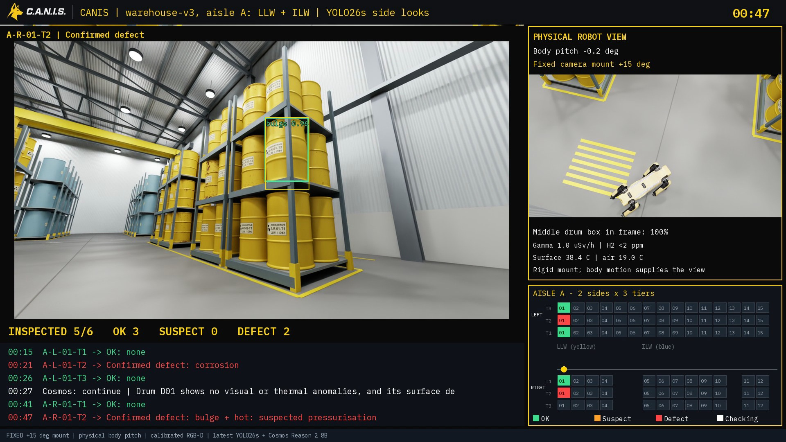
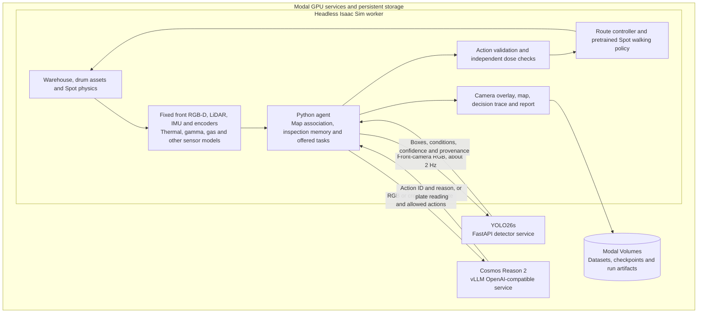

# CANIS

**Autonomous, agentic robotic inspection for nuclear waste stores.** Built for the AgentVerse 2026 robotics track with NVIDIA Isaac Sim, YOLO26s, Cosmos Reason 2 and Modal.

## The problem

Robotic dogs such as Boston Dynamics Spot already inspect nuclear facilities, including [Sellafield](https://www.gov.uk/government/case-studies/how-are-robot-dogs-helping-clean-up-sellafield), collecting images, radiation measurements and environmental data. Their inspection workflows still face practical problems:

- **Predetermined routes and checks.** Standard [Autowalk missions](https://dev.bostondynamics.com/docs/concepts/autonomy/autowalk_service.html) visit predefined stops and perform assigned actions. Changing the next task after an unexpected finding requires additional decision logic.
- **Incomplete visual coverage.** Rack posts, poor lighting and upper-tier placement can obscure rust or bulging. An unclear image needs another viewpoint before the drum can be considered inspected.
- **Alarms require follow-up decisions.** A hot surface, a bulge and rising radiation need different responses. Whether to recheck the drum, inspect its neighbours, keep a safe distance or alert an operator must still be configured or decided.
- **Human follow-up adds time and exposure.** Uncertain findings require review and can trigger repeat inspections. Where workers must enter hazardous areas, those visits also involve protective equipment and radiation controls.

**Containment failures have substantial financial consequences.** In 2014, a [compromised waste drum caused a radioactive release at WIPP](https://www.epa.gov/radiation/2014-radiological-event-wipp). During recovery from that release and a separate truck fire, GAO reported **about US$64 million in additional restart costs and nearly nine months of delay** beyond the initial estimates. [GAO's 2016 recovery assessment](https://www.gao.gov/products/gao-16-608).

## CANIS: from an observation to a decision

CANIS is an **autonomous, agentic inspection system for robotic dogs**, demonstrated with Boston Dynamics Spot in NVIDIA Isaac Sim. It combines visual findings, sensor readings and inspection memory to decide what to investigate next. The agent can revisit a suspect drum, move for a clearer view, reread a plate, collect another measurement, request a virtual swab, or retreat and alert an operator.

The mission goal is to collect the required evidence for every assigned drum and report what remains unresolved. A separate safety layer constrains the choices available to the reasoning model and can stop motion independently.



*Frame from the latest six-drum recording: YOLO26s detects a bulging drum with a 38.4°C surface reading (19.0°C air), flagged as suspected pressurisation. The run uses Cosmos Reason 2–8B and a rigid camera mounted 15° upward.*

| What CANIS observes | How it responds |
|---|---|
| Rust or a bulging barrel in the front camera | Associate the finding with a drum; inspect again if evidence is uncertain |
| An unreadable plate or a possible inventory mismatch | Reposition the robot and request another plate read |
| Bulging together with elevated surface temperature | Flag suspected pressurisation for review; retain the supporting readings |
| Rising radiation or corroborating heat, gas and hiss findings | Apply the configured motion limits or select an alert and retreat |
| Missing inspection evidence | Keep the drum pending, retry within a budget, or explicitly defer it |

The recording overlay shows the robot's camera, detections, sensor values, visited trail, inspection progress and actual model decisions. Each run also produces a structured report linking findings to the evidence collected.

[Recorded mission and artifacts](docs/mission_recording_20261108.md) · [Front-camera recording workflow](docs/front_camera_recording.md) · [Environment previews and walkthrough](docs/previews/README.md)

## Latest detector for teammates

The latest warehouse-v3 recordings use the separately hosted **expanded YOLO26s**, fine-tuned using a **2,500-image synthetic dataset**: **2,000 training / 235 validation / 265 test images**, with 1,500 yellow LLW and 1,000 metallic/blue-teal ILW primary targets overall. Start with [the latest-model handoff](detector/v2/LATEST_MODEL.md) for the exact endpoint, private credential setup, checkpoint hash and worker configuration. **Select its URL explicitly:** the previous 1,500-image model remains deployed and is still the default in the client and `selected_model.json`. The expanded model is experimental and does not improve every test subset.

## How we used Modal

Modal provides the GPU infrastructure for the simulation, synthetic-data pipeline, model training and deployed inference services. Development runs from a local checkout; the GPU workloads and persistent artifacts live in Modal workspaces.

| Workload | What runs on Modal | Why it matters |
|---|---|---|
| **Headless simulation** | The official Isaac Sim 6.2 container, an RTX-capable GPU, the warehouse scene and Spot's pretrained walking policy | Runs physics and sensor rendering without a local NVIDIA workstation or interactive desktop |
| **Fast iteration and recording** | A warm Isaac worker receives scripts through a Modal Queue; a Dict tracks requests and results | Reuses the loaded simulator across iterations and returns screenshots, sensor logs and encoded MP4s |
| **Synthetic dataset curation** | Independent GPU workers generate seeded scenes, render camera views and export semantic ground truth as YOLO boxes | Produces labeled examples with randomized faults, printed IDs, viewpoints and lighting |
| **Training and fine-tuning** | Separate PyTorch/Ultralytics containers fine-tune pretrained YOLO26 models | Keeps training dependencies separate from Isaac's bundled Python and compares models on the same held-out data |
| **Detector hosting** | YOLO26s behind an authenticated FastAPI service on an RTX PRO 6000 | Gives the robot and teammates a shared image-to-condition API; scales to zero when idle |
| **NVIDIA model serving** | Cosmos Reason 2 behind vLLM's OpenAI-compatible `/v1/chat/completions` API | Serves image-and-state reasoning and plate-reading requests independently of the simulator |
| **Persistence and access** | Modal Volumes for datasets, checkpoints, caches and run artifacts; Secrets for service credentials | Preserves work between jobs and keeps credentials out of Git and recordings |

### From rendered scenes to a trained detector

The latest **YOLO26s** uses **2,500 procedurally generated Isaac Sim images**. We retained the original 1,500 mixed-material images and added **750 yellow LLW + 250 blue-teal ILW images**, producing the current dataset:

| Dataset property | Latest expanded release |
|---|---|
| Images | **2,500** warehouse views, rendered at **384 × 384** |
| Primary-target materials | **1,500 yellow LLW + 1,000 metallic/blue-teal ILW** |
| Split | **2,000 training / 235 validation / 265 test** |
| Condition classes | `normal`, `rust`, `bulge`, `rust_and_bulge` |
| Labels | Whole-barrel bounding boxes in YOLO format: `class x_center y_center width height`, with normalized coordinates |
| Dataset version | `canis_colors_20261108T053740Z` |

Images include the target drum and visible surrounding drums, with one condition label per labeled barrel. Printed IDs, rust patterns, bulge shape, viewpoints and lighting are randomized independently of the condition. Requested viewing angles span approximately **−60° to +60°**. Training examples cover **tiers 1–2**; tier-3 fault accuracy has not been established.

Independent **RTX PRO 6000 render jobs** reuse a warm Isaac process across scene seeds. The original generation submitted ten jobs; the expansion recipe uses five yellow and five ILW jobs. Scene seeds are kept disjoint across training, validation and test, and the original split assignments are preserved. The combined training list and training sampler shuffle yellow and ILW examples together.

The current small model continued from the previous YOLO26s checkpoint for **20 epochs**, with learning rate **0.0001**, batch size **64**, AdamW and **one RTX PRO 6000**. Training took **68.8 seconds**, or **76.6 seconds including evaluation**, excluding dataset generation and GPU startup. Validation selected the expanded candidate; test images were held out for final evaluation.

| Latest held-out synthetic test metric | Expanded YOLO26s |
|---|---:|
| Primary-barrel condition accuracy | **233/265 (87.9%)** |
| Yellow LLW primary-barrel accuracy | **163/165 (98.8%)** |
| Metallic/blue-teal ILW primary-barrel accuracy | **70/100 (70.0%)** |
| Detection mAP50 across all labeled barrels | **82.9%** |
| Detection mAP50–95 across all labeled barrels | **78.3%** |

Primary-barrel accuracy scores the designated target in each frame; mAP includes all labeled barrels. These are synthetic test results. On the same 265 test frames, the previous model also scored 87.9% overall; the expanded model improved the yellow subsets and regressed on the original ILW subset. The earlier nano/small comparison and full per-group results remain in [the versioned evaluation](detector/v2/RUN_RESULTS.md).

The dataset, best weights, training logs and test artifacts persist in Modal Volumes. The expanded model is served at its own authenticated endpoint, while the previous model remains available as the repository default. [Exact model, endpoint and artifact paths](detector/v2/LATEST_MODEL.md).

[Generate the expanded dataset and fine-tune](detector/v2/COLOR_RETRAIN.md) · [Call the latest YOLO26s API](detector/v2/API_USAGE.md) · [Shared Cosmos Reason 2 8B endpoint](docs/cosmos_8b_api.md) · [Cosmos vLLM deployment](tools/cosmos_vllm.py)

## Technical architecture

The **Python agent coordinates the models**. YOLO supplies visual observations; Cosmos selects a permitted task; the navigation controller and learned walking policy execute it. The models communicate through the agent's structured state and authenticated HTTPS services.



### 1. Build the world and acquire observations

USD scene assets describe the hall, drum geometry, printed plates and authored faults. Isaac Sim provides Spot's articulated body, contact physics, rendered RGB/depth, RTX LiDAR, IMU and joint-state sensing. Additional Python sensor models supply thermal, gamma dose, accumulated dose, gas, humidity, microphone and virtual-swab observations.

The **front RGB-D camera is rigidly mounted to Spot's physical body**. It follows the robot's translation, gait, height and orientation. YOLO receives that camera's RGB; Cosmos receives the same view or a declared digital crop for plate reading. The small third-person recording view is for presentation. Thermal imagery is registered to the front view.

Sensor fixtures derive readings from the simulated world. Authored fault labels are used for dataset generation and evaluation, not supplied to the planner as inspection findings.

[Environment handoff](docs/environment_handoff.md) · [Camera mechanics](docs/front_camera_recording.md) · [Sensor models and criteria](docs/sensors_and_criteria.md)

### 2. Detect, locate and remember

The selected YOLO26s model returns one box per detected barrel with a condition and confidence. It does not predict individual rust-patch counts, a corrosion-area percentage, temperature or gas pressure.

The agent back-projects box-interior depth samples using camera calibration and the estimated robot pose, then associates the result with a drum in the known store map. LiDAR scan matching corrects the pose estimated from leg odometry and the IMU. A plate read is a separate identity check against inventory.

A per-drum ledger retains visual observations, identity reads, thermal readings, optional swab results, missing checks and derived condition status. The coverage workflow requires two sufficiently distinct visual viewpoints; repeated frames from one stationary pose do not count as another angle. The map displays the estimated visited trail, current route and pending, complete or deferred inspections.

[Detector contract](detector/v2/API_USAGE.md) · [Map, ledger and coverage implementation](docs/full_store_mission.md)

### 3. Reason, constrain and act

On an eligible planning event, the agent sends Cosmos the front image, a JSON snapshot of sensor readings and findings, inspection progress and the currently offered actions. Cosmos returns an `action_id` and a short reason. Python validates the choice, updates the task state and uses a labeled rules fallback if the response is invalid or the service fails.

The route controller converts the chosen task into waypoints and body-relative velocity commands. Isaac's pretrained Spot locomotion policy converts those commands into joint targets. Cosmos chooses inspection tasks; it does not output individual footsteps.

Dose checks can veto motion independently of model inference. Visible bulging plus surface temperature at least **5°C above ambient** is a configurable **suspected-pressurisation screen**. It does not establish internal gas pressure; gas and acoustic observations remain separate evidence.

| Component | Update pattern |
|---|---|
| Physics and locomotion | Physics substeps and the loaded walking policy's control rate |
| Camera, sensor features, memory and overlay | Approximately 12 agent cycles per simulated second in the recorded workflow |
| YOLO detection | Approximately 2 requests per simulated second; latest result reused between requests |
| Cosmos planning | Event-driven: new findings, eligible task transitions and follow-up decisions |
| Plate reading | When a plate is visible and eligible for an initial read or requested reread |
| Report | Evidence accumulates during the run; final structured report is assembled when it ends |

Inference calls are synchronous in this prototype, so simulation time pauses while waiting for a model response. Video playback rate is not a claim of real-time execution speed.

[Detailed evidence flow and timing](docs/agentic_architecture.md) · [Inspection criteria and source rationale](docs/inspection_source_register.md)

### 4. Produce an evidence-backed handoff

The integrated mission assembles `report.json` and `report.md` from inspection memory, sensor observations and status rules. Its bundle also includes decisions, telemetry, model-request provenance, timings and the MP4. The warehouse-v3 two-drum recheck demo writes its own `tilt_report.json` and `report.md` beside the recording, with the original and repeat views saved in `inputs/`.

The report lists inspected, pending and deferred drums, unresolved findings and operator follow-up. **Coverage and condition are separate:** collecting all required observations does not imply that a drum is fault-free. The recording overlay is composited from the same run data; it is not a separate dashboard service.

## Post-CANIS report

After a run, the logs can be turned into a report for store managers and safety staff. It says which drums need action, where people can safely go and what evidence supports each call. The same process works for any run or detector that logs the same fields.

1. **Collect the run's logs:** drum memory, decisions, telemetry and evidence photos.
2. **Rate each drum** with fixed rules: *Action needed*, *Check again* or *No problem found*.
3. **Rate each 2 m of the aisle:** *Safe*, *Restricted*, *Keep out* or *Not checked*. A section is only *Safe* if radiation was measured there.
4. **Assemble the report:** a summary, the aisle plan, every drum, a photo and next step for each flagged drum, what was not checked, and accuracy against the simulation's seeded faults.
5. **Check it before sharing,** including that each photo really shows the drum it is filed under.

Anything the run did not log is printed as `not measured`. Fixed rules set every rating; a language model can only add a labelled explanation for a drum that needs action.

[Report framework](docs/report_framework/README.md) · [Worked example with invented data](docs/report_framework/example/expected_report.md)

The [PDF generator on the report branch](https://github.com/tika/agentverse26/tree/canis-report-pdf/tools/full_hall_report/pdf) formats a compatible full-hall run bundle. Its bundled PDF preview comes from a separate simulated run. The two-drum recording uses the smaller evidence report described in the [rigid-camera run guide](docs/rigid_camera_demos.md#ambiguous-upper-tier-view-with-cosmos-reason-2-8b).

## What is demonstrated today

| Workstream | Evidence and current scope |
|---|---|
| **Warehouse-v3 recheck** | In the two-drum simulation, a clipped upper-tier view led Cosmos Reason 2 8B to add a higher look. The projected drum box went from 78% to 100% in frame. The detector endpoint returned HTTP 404, so the run left drum condition unresolved. [Reproduce the test](docs/rigid_camera_demos.md#ambiguous-upper-tier-view-with-cosmos-reason-2-8b) |
| **Integrated mission** | A recorded eight-drum job in the 28-drum hall: 64 successful YOLO requests and four live Cosmos decisions, including virtual swabbing and retreat/alert. This recording used the earlier detector. [Run and artifacts](docs/mission_recording_20261108.md) |
| **Full-store coverage** | Routing, a visited trail, a ledger and checkpoints for all 28 drums. The documented partial run reached 11/28 observation sets before it was cut; full completion is not validated. [Coverage status](docs/full_store_mission.md) |
| **Current perception model** | The expanded 2,500-image YOLO26s is served separately and used in recent rigid-camera tests; the previous 1,500-image model remains the default and available. These tests are separate from the earlier Cosmos mission. [Latest model and exact version](detector/v2/LATEST_MODEL.md) |
| **Warehouse development** | A separate dense stacked warehouse workstream extends the environment beyond the recorded 28-drum baseline. [Scene and run guidance](sim/README.md) |

CANIS is a simulation prototype. Domain sensor channels are simulated, thresholds are demonstration policy, and the new detector's reported accuracy is on synthetic images. The statistical policy comparison in [the evaluation](eval/EVALUATION.md) is a separate Python simulation, not a measured improvement from paired physical-robot or Isaac missions.

## Run it and explore the implementation

Start with the workflow you need:

| Goal | Entry point |
|---|---|
| Set up a team checkout and Modal workspace | [Team quickstart](docs/team_quickstart.md) |
| Run the headless simulator and live model integration | [Integration guide](docs/yolo_cosmos_integration.md) |
| Reproduce the fixed front-camera recording | [Recording guide](docs/front_camera_recording.md) |
| Build the environment or export screenshots/video | [Environment handoff](docs/environment_handoff.md) |
| Use the selected detector from another application | [YOLO26s API usage](detector/v2/API_USAGE.md) |
| Regenerate data, train or redeploy the detector | [Dataset and training pipeline](detector/v2/README.md) |
| Serve Cosmos on Modal | [vLLM deployment recipe](tools/cosmos_vllm.py) |
| Launch the 420-drum warehouse-v3 with fresh corrosion and bulging | [Warehouse-v3 defects](sim/warehouse-v3/DEFECTS.md) |
| Run the CANIS warehouse aisle walk (LLW + ILW, live YOLO26s) | [`scripts/hot/full_hall/wh_cond_walk.py`](scripts/hot/full_hall/wh_cond_walk.py) via [`tools/full_hall_report/hot_hall_canis.py`](tools/full_hall_report/hot_hall_canis.py) |
| Explore earlier prototypes and detailed commands | [Earlier development workflows](docs/legacy_workflows.md) |

The integration guides retain commands for their recorded versions. Use the selected detector's current API guide for its endpoint, credentials and four-condition response contract.

```text
sim/                        USD environment, sensors, camera and coverage logic
sim/warehouse-v3/           420-drum LLW/ILW warehouse, seeded faults and physical sensors
scripts/hot/                Perception, agent tasks and mission scripts
tools/hot_hall.py           Warm Modal simulator supervisor
tools/cosmos_vllm.py        Cosmos Reason 2 serving recipe
detector/v2/                Dataset generation, training, serving and API client
docs/                       Setup, architecture, sources, recordings and handoffs
eval/                       Separate policy-comparison simulation
```

Large datasets, checkpoints and recordings stay in Modal Volumes or ignored output folders. API credentials are shared privately and never committed.

## License

The project's original code is available under the [MIT License](LICENSE). Third-party simulator software, models, assets and dependencies are subject to their respective licenses.
