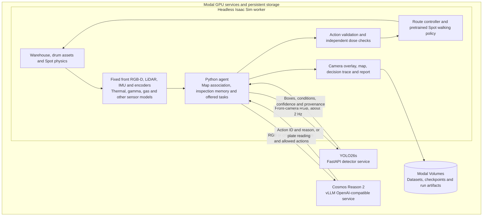

# CANIS

**Agentic inspection for nuclear waste stores.** Built for the AgentVerse 2026 robotics track with NVIDIA Isaac Sim, YOLO26s, Cosmos Reason 2 and Modal.

## The problem

Radioactive waste stores need repeated checks for container deterioration and changing environmental conditions while limiting the need for people to enter hazardous areas. Robots such as Boston Dynamics Spot already support nuclear-site inspection and data collection, including at [Sellafield](https://www.gov.uk/government/case-studies/how-are-robot-dogs-helping-clean-up-sellafield); [Autowalk missions](https://dev.bostondynamics.com/docs/concepts/autonomy/autowalk_service.html) organize autonomous visits and actions around a recorded inspection plan.

A successful round still needs to resolve what the evidence means: does a questionable drum need another view, another measurement, an operator alert, or a safe stop? Incomplete observations, ambiguous images and new hazards make those follow-up decisions as important as reaching the inspection points.

## CANIS: from an observation to a decision

CANIS is a simulated Spot inspection agent that combines visual findings, sensor readings and inspection memory to choose its next task. It can investigate a suspect drum, move to a different viewing angle, reread its plate, collect another measurement, request a virtual swab, or retreat and alert an operator.

The mission goal is to collect the required evidence for every assigned drum and report what remains unresolved. A separate safety layer constrains the choices available to the reasoning model and can stop motion independently.


*Latest warehouse-v3 two-drum camera/model test: fixed 15° upward mount, physical body pitch and the expanded YOLO26s. This rules-driven clip is separate from the earlier YOLO/Cosmos mission. [Reproduce the recording](docs/rigid_camera_demos.md).*

| What CANIS observes | How it responds |
|---|---|
| Rust or a bulging barrel in the front camera | Associate the finding with a drum; inspect again if evidence is uncertain |
| An unreadable plate or a possible inventory mismatch | Reposition the robot and request another plate read |
| Bulging together with elevated surface temperature | Flag suspected pressurisation for review; retain the supporting readings |
| Rising radiation or corroborating heat, gas and hiss findings | Apply the configured motion limits or select an alert and retreat |
| Missing inspection evidence | Keep the drum pending, retry within a budget, or explicitly defer it |

The recording overlay shows the robot's camera, detections, sensor values, visited trail, inspection progress and actual model decisions. Each run also produces a structured report linking findings to the evidence collected.

[Recorded mission and artifacts](docs/mission_recording_20261108.md) · [Front-camera recording workflow](docs/front_camera_recording.md) · [Environment previews and walkthrough](docs/previews/README.md)

## Latest detector for teammates

The recent warehouse-v3 rigid-camera recordings use the separately hosted **expanded YOLO26s**, fine-tuned on **2,500 images** (1,500 yellow LLW + 1,000 blue-teal ILW targets). Start with [the latest-model handoff](detector/v2/LATEST_MODEL.md) for the exact endpoint, private credential setup, checkpoint hash and worker configuration. **Select its URL explicitly:** the previous 1,500-image model remains deployed and is still the default in the client and `selected_model.json`. The expanded model is experimental and does not improve every test subset.

## How we used Modal

Modal provides the GPU infrastructure for the simulation, synthetic-data pipeline, model training and deployed inference services. Development runs from a local checkout; the GPU workloads and persistent artifacts live in Modal workspaces.

| Workload | What runs on Modal | Why it matters |
|---|---|---|
| **Headless simulation** | The official Isaac Sim 6.2 container, an RTX-capable GPU, the warehouse scene and Spot's pretrained walking policy | Runs physics and sensor rendering without a local NVIDIA workstation or interactive desktop |
| **Fast iteration and recording** | A warm Isaac worker receives scripts through a Modal Queue; a Dict tracks requests and results | Reuses the loaded simulator across iterations and returns screenshots, sensor logs and encoded MP4s |
| **Synthetic dataset curation** | Independent GPU workers generate seeded scenes, render camera views and export semantic ground truth as YOLO boxes | Produces labeled examples with randomized faults, printed IDs, viewpoints and lighting |
| **Training and fine-tuning** | Separate PyTorch/Ultralytics containers fine-tune pretrained YOLO26 models | Keeps training dependencies separate from Isaac's bundled Python and compares models on the same held-out data |
| **Detector hosting** | YOLO26s behind an authenticated FastAPI service on an RTX PRO 6000 | Gives the robot and teammates a shared image-to-condition API; scales to zero when idle |
| **NVIDIA model serving** | Pretrained `nvidia/Cosmos-Reason2-2B` behind vLLM's OpenAI-compatible `/v1/chat/completions` API | Serves image-and-state reasoning and plate-reading requests independently of the simulator |
| **Persistence and access** | Modal Volumes for datasets, checkpoints, caches and run artifacts; Secrets for service credentials | Preserves work between jobs and keeps credentials out of Git and recordings |

### From rendered scenes to a trained detector

We iterated through small visual pilots, a 40-image diversity pilot and an earlier 1,200-image release before generating the original **1,500-image condition dataset**. That run submitted **10 RTX PRO 6000 worker jobs**; Modal initially allocated eight while two queued. Each worker reused one Isaac process across five procedural scene seeds.

That 1,500-image dataset contains **23,935 whole-barrel boxes** with four simple classes: **normal**, **rust**, **bulge** and **rust_and_bulge**. Printed IDs are randomized independently of condition. Scene seeds stay within one split: **1,200 training / 150 validation / 150 test images**, rendered at 384 × 384.

YOLO26 nano and small were fine-tuned concurrently on **one RTX PRO 6000 each**. We selected **YOLO26s** for its stronger held-out results and retired nano's API while retaining both checkpoints and evaluation reports.

| Held-out synthetic test metric | YOLO26n | **YOLO26s — selected** |
|---|---:|---:|
| Primary-barrel condition accuracy | 75.3% | **85.3%** |
| Detection mAP50 across all labeled barrels | 73.3% | **77.9%** |
| Yellow LLW primary-barrel accuracy | 96.0% | **96.0%** |
| Metallic ILW primary-barrel accuracy | 54.7% | **74.7%** |

These baseline measurements come from 150 held-out synthetic frames, not the expanded model. The later 2,500-image continuation uses 2,000 training / 235 validation / 265 test frames. On matched test subsets, original-yellow accuracy is 97.3% versus 96.0% previously, while original-ILW accuracy is 70.7% versus 74.7%. [Expanded results and limitations](detector/v2/RUN_RESULTS.md) report the full comparison.

Primary-target accuracy and mAP measure different things; the [full results](detector/v2/RUN_RESULTS.md) include background barrels, per-condition errors, timings and limitations.

[Generate and train](detector/v2/README.md) · [Call the selected YOLO26s API](detector/v2/API_USAGE.md) · [Cosmos vLLM deployment](tools/cosmos_vllm.py)

## Technical architecture

The **Python agent coordinates the models**. YOLO supplies visual observations; Cosmos selects a permitted task; the navigation controller and learned walking policy execute it. The models communicate through the agent's structured state and authenticated HTTPS services.



### 1. Build the world and acquire observations

USD scene assets describe the hall, drum geometry, printed plates and authored faults. Isaac Sim provides Spot's articulated body, contact physics, rendered RGB/depth, RTX LiDAR, IMU and joint-state sensing. Additional Python sensor models supply thermal, gamma dose, accumulated dose, gas, humidity, microphone and virtual-swab observations.

The **front RGB-D camera is rigidly mounted to Spot's physical body**. It follows the robot's translation, gait, height and orientation. YOLO receives that camera's RGB; Cosmos receives the same view or a declared digital crop for plate reading. The small third-person recording view is for presentation. Thermal imagery is registered to the front view.

Sensor fixtures derive readings from the simulated world. Authored fault labels are used for dataset generation and evaluation, not supplied to the planner as inspection findings.

[Environment handoff](docs/environment_handoff.md) · [Camera mechanics](docs/front_camera_recording.md) · [Sensor models and criteria](docs/sensors_and_criteria.md)

### 2. Detect, locate and remember

The selected YOLO26s model returns one box per detected barrel with a condition and confidence. It does not predict individual rust-patch counts, a corrosion-area percentage, temperature or gas pressure.

The agent back-projects box-interior depth samples using camera calibration and the estimated robot pose, then associates the result with a drum in the known store map. LiDAR scan matching corrects the pose estimated from leg odometry and the IMU. A plate read is a separate identity check against inventory.

A per-drum ledger retains visual observations, identity reads, thermal readings, optional swab results, missing checks and derived condition status. The coverage workflow requires two sufficiently distinct visual viewpoints; repeated frames from one stationary pose do not count as another angle. The map displays the estimated visited trail, current route and pending, complete or deferred inspections.

[Detector contract](detector/v2/API_USAGE.md) · [Map, ledger and coverage implementation](docs/full_store_mission.md)

### 3. Reason, constrain and act

On an eligible planning event, the agent sends Cosmos the front image, a JSON snapshot of sensor readings and findings, inspection progress and the currently offered actions. Cosmos returns an `action_id` and a short reason. Python validates the choice, updates the task state and uses a labeled rules fallback if the response is invalid or the service fails.

The route controller converts the chosen task into waypoints and body-relative velocity commands. Isaac's pretrained Spot locomotion policy converts those commands into joint targets. Cosmos chooses inspection tasks; it does not output individual footsteps.

Dose checks can veto motion independently of model inference. Visible bulging plus surface temperature at least **5°C above ambient** is a configurable **suspected-pressurisation screen**. It does not establish internal gas pressure; gas and acoustic observations remain separate evidence.

| Component | Update pattern |
|---|---|
| Physics and locomotion | Physics substeps and the loaded walking policy's control rate |
| Camera, sensor features, memory and overlay | Approximately 12 agent cycles per simulated second in the recorded workflow |
| YOLO detection | Approximately 2 requests per simulated second; latest result reused between requests |
| Cosmos planning | Event-driven: new findings, eligible task transitions and follow-up decisions |
| Plate reading | When a plate is visible and eligible for an initial read or requested reread |
| Report | Evidence accumulates during the run; final structured report is assembled when it ends |

Inference calls are synchronous in this prototype, so simulation time pauses while waiting for a model response. Video playback rate is not a claim of real-time execution speed.

[Detailed evidence flow and timing](docs/agentic_architecture.md) · [Inspection criteria and source rationale](docs/inspection_source_register.md)

### 4. Produce an evidence-backed handoff

Python assembles `report.json` and `report.md` from inspection memory, sensor observations and status rules. The bundle also contains decisions, telemetry, model-request provenance, timings and the recorded MP4. Cosmos's generated reasons are retained alongside the observations that were available to it.

The report lists inspected, pending and deferred drums, unresolved findings and operator follow-up. **Coverage and condition are separate:** collecting all required observations does not imply that a drum is fault-free. The recording overlay is composited from the same run data; it is not a separate dashboard service.

## What is demonstrated today

| Workstream | Evidence and current scope |
|---|---|
| **Integrated mission** | A recorded eight-drum job in the 28-drum hall: 64 successful YOLO requests and four live Cosmos decisions, including virtual swabbing and retreat/alert. This recording used the earlier detector. [Run and artifacts](docs/mission_recording_20261108.md) |
| **Full-store coverage** | Routing, a visited trail, a ledger and checkpoints for all 28 drums. The documented partial run reached 11/28 observation sets before it was cut; full completion is not validated. [Coverage status](docs/full_store_mission.md) |
| **Current perception model** | The expanded 2,500-image YOLO26s is served separately and used in recent rigid-camera tests; the previous 1,500-image model remains the default and available. These tests are separate from the earlier Cosmos mission. [Latest model and exact version](detector/v2/LATEST_MODEL.md) |
| **Warehouse development** | A separate dense stacked warehouse workstream extends the environment beyond the recorded 28-drum baseline. [Scene and run guidance](sim/README.md) |

CANIS is a simulation prototype. Domain sensor channels are simulated, thresholds are demonstration policy, and the new detector's reported accuracy is on synthetic images. The statistical policy comparison in [the evaluation](eval/EVALUATION.md) is a separate Python simulation, not a measured improvement from paired physical-robot or Isaac missions.

## Run it and explore the implementation

Start with the workflow you need:

| Goal | Entry point |
|---|---|
| Set up a team checkout and Modal workspace | [Team quickstart](docs/team_quickstart.md) |
| Run the headless simulator and live model integration | [Integration guide](docs/yolo_cosmos_integration.md) |
| Reproduce the fixed front-camera recording | [Recording guide](docs/front_camera_recording.md) |
| Build the environment or export screenshots/video | [Environment handoff](docs/environment_handoff.md) |
| Use the selected detector from another application | [YOLO26s API usage](detector/v2/API_USAGE.md) |
| Regenerate data, train or redeploy the detector | [Dataset and training pipeline](detector/v2/README.md) |
| Serve Cosmos on Modal | [vLLM deployment recipe](tools/cosmos_vllm.py) |
| Launch the 420-drum warehouse-v3 with fresh corrosion and bulging | [Warehouse-v3 defects](sim/warehouse-v3/DEFECTS.md) |
| Run the CANIS warehouse aisle walk (LLW + ILW, live YOLO26s) | [`scripts/hot/full_hall/wh_cond_walk.py`](scripts/hot/full_hall/wh_cond_walk.py) via [`tools/full_hall_report/hot_hall_canis.py`](tools/full_hall_report/hot_hall_canis.py) |
| Explore earlier prototypes and detailed commands | [Earlier development workflows](docs/legacy_workflows.md) |

The integration guides retain commands for their recorded versions. Use the selected detector's current API guide for its endpoint, credentials and four-condition response contract.

```text
sim/                        USD environment, sensors, camera and coverage logic
sim/warehouse-v3/           420-drum LLW/ILW warehouse, seeded faults and physical sensors
scripts/hot/                Perception, agent tasks and mission scripts
tools/hot_hall.py           Warm Modal simulator supervisor
tools/cosmos_vllm.py        Cosmos Reason 2 serving recipe
detector/v2/                Dataset generation, training, serving and API client
docs/                       Setup, architecture, sources, recordings and handoffs
eval/                       Separate policy-comparison simulation
```

Large datasets, checkpoints and recordings stay in Modal Volumes or ignored output folders. API credentials are shared privately and never committed.

## License

The project's original code is available under the [MIT License](LICENSE). Third-party simulator software, models, assets and dependencies are subject to their respective licenses.
