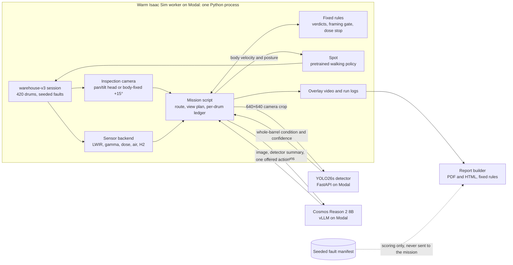

# CANIS

**Autonomous, agentic robotic inspection for nuclear waste stores.** Built for the AgentVerse 2026 robotics track with NVIDIA Isaac Sim, YOLO26s, Cosmos Reason 2 and Modal.

## The problem

Robotic dogs such as Boston Dynamics Spot already inspect nuclear facilities, including [Sellafield](https://www.gov.uk/government/case-studies/how-are-robot-dogs-helping-clean-up-sellafield), collecting images, radiation measurements and environmental data. Their inspection workflows still face practical problems:

- **Predetermined routes and checks.** Standard [Autowalk missions](https://dev.bostondynamics.com/docs/concepts/autonomy/autowalk_service.html) visit predefined stops and perform assigned actions. Changing the next task after an unexpected finding requires additional decision logic.
- **Incomplete visual coverage.** Rack posts, poor lighting and upper-tier placement can obscure rust or bulging. An unclear image needs another viewpoint before the drum can be considered inspected.
- **Alarms require follow-up decisions.** A hot surface, a bulge and rising radiation need different responses. Whether to recheck the drum, inspect its neighbours, keep a safe distance or alert an operator must still be configured or decided.
- **Human follow-up adds time and exposure.** Uncertain findings require review and can trigger repeat inspections. Where workers must enter hazardous areas, those visits also involve protective equipment and radiation controls.

**Containment failures have substantial financial consequences.** In 2014, a [compromised waste drum caused a radioactive release at WIPP](https://www.epa.gov/radiation/2014-radiological-event-wipp). During recovery from that release and a separate truck fire, GAO reported **about US$64 million in additional restart costs and nearly nine months of delay** beyond the initial estimates. [GAO's 2016 recovery assessment](https://www.gao.gov/products/gao-16-608).

## CANIS: from an observation to a decision

CANIS is an **agentic inspection system for robot dogs**, demonstrated with Boston Dynamics Spot in a simulated 420-drum waste store in NVIDIA Isaac Sim. Spot walks the aisles, a detector checks every drum it sees, fixed rules decide which drums are confirmed, cleared or still unclear, and Cosmos Reason 2 chooses the next step when the evidence is not good enough. A fixed dose rule can stop the round and back the robot off regardless of any model.

Each run ends in a report for store managers: which drums need action, where gamma was measured and what was not checked.


*Frame from a six-drum warehouse-v3 recording with a body-fixed camera mounted 15° upward. YOLO26s flags a bulging drum; the overlay shows a 38.4°C surface reading against 19.0°C air and marks it as suspected pressurisation.*

| What CANIS observes | How it responds | Where it runs today |
|---|---|---|
| Rust or bulging on a drum | Confirms it only when the fault appears in at least two of three views; otherwise takes a closer look | Aisle patrol and rigid-camera walk |
| A drum only partly in frame, or an unclear detector result | Cosmos chooses another view or hands the drum to an operator; a partial view never clears a drum | Rigid-camera walk and upper-tier recheck |
| Missing evidence | Marks the drum or aisle section *not checked* in the report instead of guessing | All runs that produce the report |

An earlier 28-drum hall prototype also read drum ID plates, took virtual swabs and chose retreat-and-alert through a Cosmos planner. Those features are described in [the earlier mission recording](docs/mission_recording_20261108.md) and are not part of the warehouse-v3 runs.

[Rigid-camera runs](docs/rigid_camera_demos.md) · [Environment previews and walkthrough](docs/previews/README.md)

## Latest detector for teammates

The latest warehouse-v3 recordings use the separately hosted **expanded YOLO26s**, fine-tuned using a **2,500-image synthetic dataset**: **2,000 training / 235 validation / 265 test images**, with 1,500 yellow LLW and 1,000 metallic/blue-teal ILW primary targets overall. Start with [the latest-model handoff](detector/v2/LATEST_MODEL.md) for the exact endpoint, private credential setup, checkpoint hash and worker configuration. **Select its URL explicitly:** the previous 1,500-image model remains deployed and is still the default in the client and `selected_model.json`. The expanded model is experimental and does not improve every test subset.

## How we used Modal

Modal provides the GPU infrastructure for the simulation, synthetic-data pipeline, model training and deployed inference services. Development runs from a local checkout; the GPU workloads and persistent artifacts live in Modal workspaces.

| Workload | What runs on Modal | Why it matters |
|---|---|---|
| **Headless simulation** | The official Isaac Sim 6.2 container, an RTX-capable GPU, the warehouse scene and Spot's pretrained walking policy | Runs physics and sensor rendering without a local NVIDIA workstation or interactive desktop |
| **Fast iteration and recording** | A warm Isaac worker receives scripts through a Modal Queue; a Dict tracks requests and results | Reuses the loaded simulator across iterations and returns screenshots, sensor logs and encoded MP4s |
| **Synthetic dataset curation** | Independent GPU workers generate seeded scenes, render camera views and export semantic ground truth as YOLO boxes | Produces labeled examples with randomized faults, printed IDs, viewpoints and lighting |
| **Training and fine-tuning** | Separate PyTorch/Ultralytics containers fine-tune pretrained YOLO26 models | Keeps training dependencies separate from Isaac's bundled Python and compares models on the same held-out data |
| **Detector hosting** | YOLO26s behind an authenticated FastAPI service on an RTX PRO 6000 | Gives the robot and teammates a shared image-to-condition API; scales to zero when idle |
| **NVIDIA model serving** | Cosmos Reason 2 8B (`nvidia/Cosmos-Reason2-8B`) behind vLLM's OpenAI-compatible `/v1/chat/completions` API | Serves image-and-state decisions independently of the simulator; one shared endpoint for the team |
| **Persistence and access** | Modal Volumes for datasets, checkpoints, caches and run artifacts; Secrets for service credentials | Preserves work between jobs and keeps credentials out of Git and recordings |

### From rendered scenes to a trained detector

The latest **YOLO26s** uses **2,500 procedurally generated Isaac Sim images**. We retained the original 1,500 mixed-material images and added **750 yellow LLW + 250 blue-teal ILW images**, producing the current dataset:

| Dataset property | Latest expanded release |
|---|---|
| Images | **2,500** warehouse views, rendered at **384 × 384** |
| Primary-target materials | **1,500 yellow LLW + 1,000 metallic/blue-teal ILW** |
| Split | **2,000 training / 235 validation / 265 test** |
| Condition classes | `normal`, `rust`, `bulge`, `rust_and_bulge` |
| Labels | Whole-barrel bounding boxes in YOLO format: `class x_center y_center width height`, with normalized coordinates |
| Dataset version | `canis_colors_20261108T053740Z` |

Images include the target drum and visible surrounding drums, with one condition label per labeled barrel. Printed IDs, rust patterns, bulge shape, viewpoints and lighting are randomized independently of the condition. Requested viewing angles span approximately **−60° to +60°**. Training examples cover **tiers 1–2**; tier-3 fault accuracy has not been established.

Independent **RTX PRO 6000 render jobs** reuse a warm Isaac process across scene seeds. The original generation submitted ten jobs; the expansion recipe uses five yellow and five ILW jobs. Scene seeds are kept disjoint across training, validation and test, and the original split assignments are preserved. The combined training list and training sampler shuffle yellow and ILW examples together.

The current small model continued from the previous YOLO26s checkpoint for **20 epochs**, with learning rate **0.0001**, batch size **64**, AdamW and **one RTX PRO 6000**. Training took **68.8 seconds**, or **76.6 seconds including evaluation**, excluding dataset generation and GPU startup. Validation selected the expanded candidate; test images were held out for final evaluation.

| Latest held-out synthetic test metric | Expanded YOLO26s |
|---|---:|
| Primary-barrel condition accuracy | **233/265 (87.9%)** |
| Yellow LLW primary-barrel accuracy | **163/165 (98.8%)** |
| Metallic/blue-teal ILW primary-barrel accuracy | **70/100 (70.0%)** |
| Detection mAP50 across all labeled barrels | **82.9%** |
| Detection mAP50–95 across all labeled barrels | **78.3%** |

Primary-barrel accuracy scores the designated target in each frame; mAP includes all labeled barrels. These are synthetic test results. On the same 265 test frames, the previous model also scored 87.9% overall; the expanded model improved the yellow subsets and regressed on the original ILW subset. The earlier nano/small comparison and full per-group results remain in [the versioned evaluation](detector/v2/RUN_RESULTS.md).

The dataset, best weights, training logs and test artifacts persist in Modal Volumes. The expanded model is served at its own authenticated endpoint, while the previous model remains available as the repository default. [Exact model, endpoint and artifact paths](detector/v2/LATEST_MODEL.md).

[Generate the expanded dataset and fine-tune](detector/v2/COLOR_RETRAIN.md) · [Call the latest YOLO26s API](detector/v2/API_USAGE.md) · [Shared Cosmos Reason 2 8B endpoint](docs/cosmos_8b_api.md) · [Cosmos vLLM deployment](tools/cosmos_vllm.py)

## Technical architecture

Everything runs on Modal. One warm Isaac Sim worker holds the warehouse, Spot and the mission script in a single Python process. The detector and Cosmos are separate GPU services reached over authenticated HTTPS, and the report is built from the run's logs afterwards. **The mission script coordinates everything**: models never call each other, and no model output becomes a verdict without passing a fixed rule.



### Three mission scripts on one stack

The warehouse runs share the scene, detector, rules and report, and differ in how the camera is aimed and who chooses the next step:

| Mission | Camera | Who decides | Live sensors | Output |
|---|---|---|---|---|
| [`aisle_patrol.py`](scripts/hot/full_hall/aisle_patrol.py): aisle A, 36 drums | Simulated pan/tilt head | Fixed rules, plus the dose stop | LWIR, depth, gamma, dose, air, hydrogen | Patrol video and run files for the report |
| [`wh_rigid_walk.py`](scripts/hot/full_hall/wh_rigid_walk.py) with Cosmos ([six-drum clip](scripts/hot/full_hall/wh_rigid_cosmos.py), [full aisle](scripts/hot/full_hall/wh_rigid_full_cosmos.py)) | Fixed to Spot's body, aimed by turning and leaning | Rules set verdicts; Cosmos reviews each drum and can only ask for more evidence | None | Walk video and run files for the report |
| [`rigid_middle_upper.py`](scripts/hot/full_hall/rigid_middle_upper.py) with [`ambiguity_cosmos.py`](scripts/hot/full_hall/ambiguity_cosmos.py): two-drum upper-tier recheck | Fixed to Spot's body; body pitch for higher views | A framing gate and YOLO votes set the verdict; Cosmos chooses the follow-up | Scripted heat cue in the inspection course | `tilt_report.json`, `report.md` and exact model inputs |

### 1. World and observations

The warehouse is a 24 × 28.3 m USD stage with 420 yellow LLW and blue-teal ILW drums on three-tier racks. Each session is generated from a seed (`HOT_WAREHOUSE_SEED`): rust, bulging, package contents, radiation sources and hydrogen vents change per seed and replay for a fixed seed. The fault manifest stays on the simulator side; the mission script never receives it.

[`sim/warehouse-v3/warehouse_sensors.py`](sim/warehouse-v3/warehouse_sensors.py) derives readings from that private inventory: gamma dose rate from Poisson counts through each drum's shielding, accumulated dose, air temperature and humidity, a hydrogen plume at the gas inlet, and LWIR surface temperature from the camera's depth image and the map. Isaac Sim does not model these channels natively, so they are simulated instruments, not measurements.

Spot uses Isaac's pretrained walking policy. In the warehouse runs the robot's position comes from the simulator and the target drum is chosen from the map; there is no onboard localisation or SLAM yet.

[Physical sensor interface](sim/warehouse-v3/PHYSICAL_SENSORS.md) · [Seeded defects](sim/warehouse-v3/DEFECTS.md) · [Camera mechanics](docs/rigid_camera_demos.md#camera-movement-and-outputs)

### 2. Detect and judge

When the camera has settled on a drum, the mission script sends a 640 × 640 crop to YOLO26s at most every 0.4 s of simulation time. The detector returns one box per barrel with a whole-barrel condition (`normal`, `rust`, `bulge`, `rust_and_bulge`) and a confidence. It does not measure rust area, temperature or pressure.

Fixed rules turn views into a verdict. From the side, a fault scoring at least 0.50 in two of three views confirms a defect, and two normal views with no fault clear the drum. Anything else, and every top-tier drum, gets a closer look from a second position. An empty detector response never clears a drum. In the rigid-camera recheck, a framing gate also requires the drum's projected box to sit fully inside the detector's input before any verdict.

### 3. Cosmos and its limits

Cosmos Reason 2 8B is called only when a decision is open, and it can choose only from actions the script offers for that moment:

- **Rigid-camera walk:** for an unclear drum it may choose `closer_look` or `mark_suspect`; for a drum the rules cleared it may choose `accept_ok` or `closer_look`, at most twice per stop. It is never asked about a confirmed defect and cannot clear a drum the rules left unclear. The reply must name an offered action or it is rejected.
- **Upper-tier recheck:** the request uses a strict JSON schema whose `enum` lists only the offered actions, such as `continue_inspection`, `recheck_higher` or `recheck_xy`, and `defer_for_operator`. The executor adds a view only when Cosmos selects it.

The dose stop sits outside the model. In the aisle patrol, a dose rate above 7.5 µSv/h starts a dose watch. Above 100 µSv/h, or when the projected mission dose would pass 80% of the robot's 50 mSv budget, the round stops, Spot backs off to the last point that read below 50 µSv/h, and the drums it has not reached are handed to radiation protection. The thresholds come from [`sim/inspection_config.json`](sim/inspection_config.json) and are simulation policy, not site limits.

### 4. Motion

The mission script plans stops along the aisle centre line and turns each decision into body velocity commands, plus body posture in the rigid-camera runs. Isaac's pretrained Spot policy converts those into joint targets. Cosmos chooses inspection steps; it never outputs footsteps or joint commands.

| Component | Update pattern |
|---|---|
| Physics and walking policy | Physics substeps and the policy's control rate |
| Camera, sensors and overlay | Every recorded frame, 24 frames per simulated second |
| YOLO26s | At most every 0.4 s of simulation time, once the camera has settled on a drum |
| Cosmos Reason 2 8B | Per drum review (rigid-camera walk) or per ambiguous upper-tier view (recheck) |
| Dose rule | Every gamma sample in the aisle patrol |
| Report | Once, from the run's logs, after the mission ends |

Model calls are synchronous, so simulation time pauses while waiting for a reply. Videos are recorded at simulation time; their playback speed is not a claim about real-time performance.

### 5. Evidence and handoff

Each run writes per-drum memory, decisions, detector requests, telemetry and evidence stills. The report builder turns those files into the store-manager report described below. Fixed rules set every rating, anything not logged is printed as *not measured*, and the seeded fault manifest is used only for the report's accuracy section.

## Post-CANIS report

After a run, the logs can be turned into a report for store managers and safety staff. It says which drums need action, where people can safely go and what evidence supports each call. The same process works for any run or detector that logs the same fields.

1. **Collect the run's logs:** drum memory, decisions, telemetry and evidence photos.
2. **Rate each drum** with fixed rules: *Action needed*, *Check again* or *No problem found*.
3. **Rate each 2 m of the aisle:** *Low gamma*, *Restricted*, *Keep out* or *Not checked*. A section is only *Low gamma* if radiation was measured there.
4. **Assemble the report:** a verdict and to-do list on page 1, the aisle plan, every drum, the evidence frame, readings, decision trail and next step for each flagged drum, what was not checked, and accuracy against the simulation's seeded faults.
5. **Check it before sharing,** including that each photo really shows the drum it is filed under.

Anything the run did not log is printed as `not measured`. Fixed rules set every rating; a language model can only add a labelled explanation for a drum that needs action.

[Report framework](docs/report_framework/README.md) · [Worked example with invented data](docs/report_framework/example/expected_report.md)

Build it with [`tools/full_hall_report/report/build_report.py`](tools/full_hall_report/report/README.md) (HTML + A4 PDF + `summary.json`); the page order and style are in [the framework, sections 5–6](docs/report_framework/README.md#5-what-the-report-contains-in-order). Example: [36-drum showcase report](tools/full_hall_report/report/example/CANIS_report_083203-wh_rigid_walk-de01.pdf). To add it to another pipeline, follow [`IMPLEMENTING.md`](tools/full_hall_report/report/IMPLEMENTING.md). The two-drum recording uses the smaller evidence report described in the [rigid-camera run guide](docs/rigid_camera_demos.md#ambiguous-upper-tier-view-with-cosmos-reason-2-8b).

## What is demonstrated today

| Workstream | Evidence and current scope |
|---|---|
| **36-drum aisle patrol** | Aisle A, 24 LLW and 12 ILW drums on both sides and three tiers, with live LWIR, depth, gamma and hydrogen readings. The recorded run checked 36 of 36 drums in 4 min 38 s of simulation time with 166 detector calls and no failures. Against the seeded faults it found 5 of 9 damaged drums with 1 false alarm; 3 of the 4 misses were blue-teal ILW drums. Fixed rules decide; Cosmos is not used in this run. |
| **Rigid-camera walk with Cosmos** | A six-drum clip and a full-aisle variant with the camera fixed to Spot's body. Cosmos Reason 2 8B reviews each drum and can only ask for more evidence; rules set verdicts. [Example 36-drum report](tools/full_hall_report/report/example/CANIS_report_083203-wh_rigid_walk-de01.pdf) |
| **Upper-tier recheck** | In the recorded two-drum course, the upper drum was 61% in frame on the first look. Cosmos Reason 2 8B chose `recheck_higher`, Spot pitched its body up, and the drum was 100% in frame on the second look. The current course version offers a ground reposition instead and adds a scripted heat cue. [Reproduce it](docs/rigid_camera_demos.md#barrel-inspection-course) |
| **Radiation retreat** | With a breached high-activity drum planted ahead in aisle A ([scenario](scripts/hot/full_hall/aisle_patrol_radiation.py)), the patrol entered dose watch at 7.7 µSv/h, stopped at 102 µSv/h, and backed off to a point reading 48 µSv/h. The 12 drums it had not reached were handed to radiation protection in the report. The robot's dose for the run was 0.45 µSv. |
| **Detector** | The expanded 2,500-image YOLO26s scores 87.9% on held-out synthetic images: 98.8% on yellow LLW drums and 70.0% on blue-teal ILW drums. [Latest model](detector/v2/LATEST_MODEL.md) |
| **Earlier 28-drum hall prototype** | A recorded eight-drum job with four live Cosmos planner decisions, plate reads, a virtual swab and retreat-and-alert, using the earlier detector. [Run and artifacts](docs/mission_recording_20261108.md) |

CANIS is a simulation prototype. Every result above is from simulation: sensor channels are simulated, thresholds are demonstration policy, and detector accuracy is measured on synthetic images. The policy comparison in [the evaluation](eval/EVALUATION.md) is a separate Python simulation of the decision rules on the 28-drum layout, using the latest detector's rates. It is not a measured result from Isaac or physical-robot missions.

## Run it and explore the implementation

Start with the workflow you need:

| Goal | Entry point |
|---|---|
| Set up a team checkout and Modal workspace | [Team quickstart](docs/team_quickstart.md) |
| Run the earlier 28-drum hall integration | [Integration guide](docs/yolo_cosmos_integration.md) |
| Reproduce the fixed front-camera recording | [Recording guide](docs/front_camera_recording.md) |
| Build the environment or export screenshots/video | [Environment handoff](docs/environment_handoff.md) |
| Use the selected detector from another application | [YOLO26s API usage](detector/v2/API_USAGE.md) |
| Regenerate data, train or redeploy the detector | [Dataset and training pipeline](detector/v2/README.md) |
| Serve Cosmos on Modal | [vLLM deployment recipe](tools/cosmos_vllm.py) |
| Launch the 420-drum warehouse-v3 with fresh corrosion and bulging | [Warehouse-v3 defects](sim/warehouse-v3/DEFECTS.md) |
| Run the 36-drum aisle patrol with live sensors | [`aisle_patrol_full.py`](scripts/hot/full_hall/aisle_patrol_full.py) then [`aisle_patrol.py`](scripts/hot/full_hall/aisle_patrol.py), via [`tools/full_hall_report/hot_hall_canis.py`](tools/full_hall_report/hot_hall_canis.py) |
| Run the rigid-camera walk with Cosmos | [`wh_rigid_cosmos.py`](scripts/hot/full_hall/wh_rigid_cosmos.py) or [`wh_rigid_full_cosmos.py`](scripts/hot/full_hall/wh_rigid_full_cosmos.py) then [`wh_rigid_walk.py`](scripts/hot/full_hall/wh_rigid_walk.py) |
| Reproduce the upper-tier recheck | [Rigid-camera run guide](docs/rigid_camera_demos.md) |
| Build the inspection report from a run | [Report builder](tools/full_hall_report/report/README.md) |
| Explore earlier prototypes and detailed commands | [Earlier development workflows](docs/legacy_workflows.md) |

The integration guides retain commands for their recorded versions. Use the selected detector's current API guide for its endpoint, credentials and four-condition response contract.

```text
sim/                        USD environment, sensors, camera and coverage logic
sim/warehouse-v3/           420-drum LLW/ILW warehouse, seeded faults and physical sensors
scripts/hot/                Perception, agent tasks and mission scripts
scripts/hot/full_hall/      Current warehouse-v3 missions: aisle patrol, rigid-camera walk, recheck
tools/full_hall_report/     Warm worker launcher for warehouse-v3 and the report builder
tools/hot_hall.py           Warm Modal simulator supervisor
tools/cosmos_vllm.py        Cosmos Reason 2 serving recipe (8B on the shared endpoint)
detector/v2/                Dataset generation, training, serving and API client
docs/                       Setup, architecture, sources, recordings and handoffs
eval/                       Separate policy-comparison simulation
```

Large datasets, checkpoints and recordings stay in Modal Volumes or ignored output folders. API credentials are shared privately and never committed.

## License

The project's original code is available under the [MIT License](LICENSE). Third-party simulator software, models, assets and dependencies are subject to their respective licenses.
