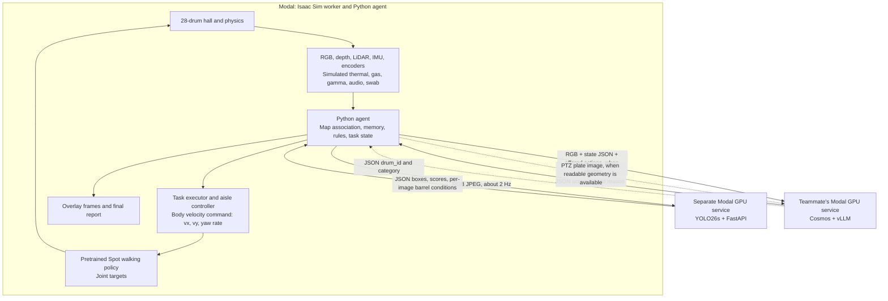
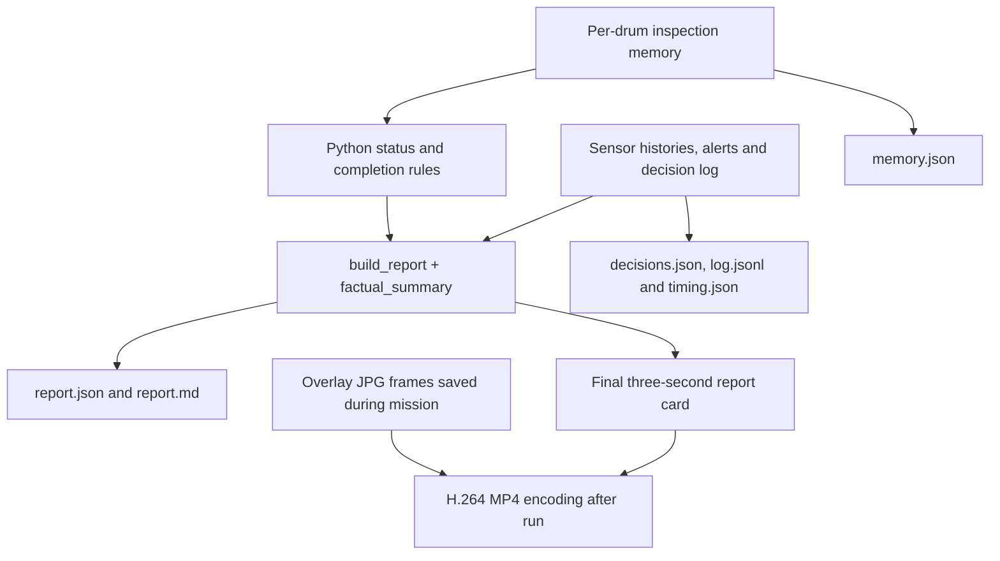

**Agentic inspection architecture — implemented version, 8 November 2026**

This describes the code and recording at commit `382786d`, rather than the
larger proposed product. Three learned components participate: the fine-tuned
YOLO26s detector, the external Cosmos vision-language service, and Isaac's
pretrained Spot locomotion policy. Python coordinates their inputs, memory,
constraints, action execution, display and reporting. Model weights do not
change during an inspection.

**1. Where everything runs**



The models do not call each other. The Python agent is the communication hub.
There is no ROS 2 bus, LangGraph graph or direct YOLO-to-Cosmos connection in
this implementation. The simulator and agent share one Python process; model
inference crosses authenticated HTTPS APIs. The YOLO deployment allows L4 with
RTX PRO 6000 fallback. The recorded Isaac worker used RTX PRO 6000. The teammate
owns the Cosmos deployment; its GPU type is not recorded in this repository.

**2. What data crosses each boundary**

| Sender → receiver | Data sent | Result |
|---|---|---|
| Isaac RGB → YOLO | 640×360 RGB encoded as JPEG; multipart POST to `/predict?band=fixed&confidence=0.25` | Drum, corrosion and bulge boxes; confidence; grouped per-image barrel conditions; model run/checkpoint metadata and timing |
| YOLO → Python association | Boxes in pixel coordinates; per-image corrosion/bulge flags | Depth samples from box interiors are back-projected using camera calibration and estimated robot pose, then matched to the nearest compatible drum footprint in the known map |
| Python → Cosmos planner | Onboard RGB JPEG, system instructions and a JSON snapshot | Exactly one offered `action_id`, plus a short generated `reason` |
| PTZ camera → Cosmos plate reader | A separately aimed 640×480 plate view and an OCR prompt | Category `LLW`/`ILW`, ID matching `[A-Z][0-9]{2}`, or unreadable/partial output |
| Task controller → Spot policy | Body-relative forward/lateral velocity and yaw rate | Policy-generated joint targets, executed by physics |

YOLO receives RGB only. It does not receive temperature, radiation, gas, map
coordinates or plate text as a separate input. Its per-image IDs such as
`drum_0` are not persistent drum identities. The Python depth/map association
assigns an inventory key, such as internal `D12`, whose displayed plate is
`C04`. Plate OCR is a separate check of what the camera can actually read.

The planner snapshot includes simulation time, estimated position, current
action, stationary flag, patrol progress, current gamma/H2/air-temperature/RH/
hiss readings, accumulated findings, per-drum inspection progress and the
offered action IDs with descriptions. Thermal temperatures, visible faults,
swab results and plate issues reach Cosmos as findings or inspection issues.
The planner does not receive the overhead video, the entire raw sensor history,
a raw LiDAR cloud or the thermal image as another image attachment.

The Cosmos caller uses OpenAI-compatible `/v1/chat/completions`, model alias
`cosmos`, temperature 0 and a 512-token output cap for planning. Plate reads use
a 256-token cap. These are API conventions; the inference service is the
teammate's vLLM deployment. YOLO uses Modal proxy authentication; Cosmos uses a
Bearer credential. Neither credential appears in the recording or logs.

**3. A single observation–action cycle**

```mermaid
sequenceDiagram
  participant S as Isaac and sensors
  participant A as Python agent and memory
  participant Y as YOLO API
  participant C as Cosmos API
  participant P as Walking policy
  S->>A: Rendered RGB, depth, latest scan, sensor samples
  A->>A: Correct pose with LiDAR; update sensor features
  opt About every 0.504 simulated seconds
    A->>Y: RGB JPEG
    Y-->>A: Boxes, scores, corrosion/bulge flags
    A->>A: Depth/map association; update visual findings
  end
  A->>A: Update per-drum checks, status and safety checks
  opt Eligible plate near robot, usually once per drum
    A->>C: Zoomed plate image
    C-->>A: Read ID/category or unreadable
    A->>A: Compare plate reading with inventory
  end
  opt New finding or follow-up complete or patrol reconsideration
    A->>A: Build constrained action list
    A->>C: RGB + observation snapshot + actions
    C-->>A: action_id and reason
    A->>A: Validate action; use labelled rules fallback on failure
  end
  A->>A: Draw overlay and retain telemetry
  A->>P: Body velocity for current task
  P->>S: Joint targets over physics substeps
  S-->>A: New position and new observations next cycle
```

If the candidate list contains only `continue_patrol`, Python continues without
calling Cosmos. Arriving, turning to face a drum, sampling, reaching the retreat
point and timing out are task-state transitions in Python. Cosmos selects the
inspection task; it does not produce individual foot placements or Python code.
The present navigation controller follows aisle/standoff waypoints. It is not a
general dynamic-obstacle path planner.

**4. Frequencies and triggers**

All frequencies below are in simulation time unless marked wall time. The loop
targets 12 output frames/s; physics-substep rounding gives 0.084 s per loop,
about 11.90 observation/action cycles/s in the recorded run.

| Component | Update schedule | What changes |
|---|---|---|
| Physics, IMU and encoder odometry | Every `spot.physics_dt` substep | Articulation state and dead-reckoned pose |
| Spot learned walking policy | Every `spot.decimation` physics ticks | Joint targets; held between control ticks |
| RGB/depth, thermal, gamma, environmental and gas sampling | Every agent loop, about 11.90 Hz | Latest camera/sensor evidence; accumulated radiation dose |
| LiDAR | Sensor profile is nominally 10 Hz; latest scan buffer consumed each agent loop | ICP pose correction against the known map; buffer reads are not guaranteed independent scans |
| YOLO | Target 2 Hz; actual request spacing 0.504 s | New predicted visual observations; previous result reused between requests |
| Gas response | Every agent loop, first-order response with 2 s time constant | H2/CH4 measurements rise/fall gradually |
| Microphone | 16 kHz synthetic waveform; classifier each agent loop | FFT-based hiss score; six consecutive positive loops create a sustained-hiss finding |
| Inspection memory and status | Each agent loop; visual checks on fresh successful YOLO results | Per-drum evidence, missing checks and status |
| Cosmos plate reading | One eligible drum per loop; generally one initial call per drum, plus explicit reread | Plate identity, readability and inventory match |
| Cosmos task planning | Event-driven while eligible; patrol reconsideration after 3 s with findings | Selected task and reason |
| Swab | 4 s sampling in this demo, polled every loop | Virtual alpha/beta-gamma contamination result; base configuration defaults to 10 s |
| Overlay | Once per agent loop; encoded at 12 fps | Visible sensors, boxes, map, task and latest decision |
| Final report | Once after the mission recording loop ends | JSON/Markdown report and three-second report card |

The precise physics rate and walking-policy rate are defined by the loaded Spot
artifact: `1 / physics_dt` and `1 / (physics_dt * decimation)`. They were not
exported in the mission manifest, so no unmeasured numerical rate is asserted.

Planning triggers are gated by the task state. During patrol a new finding sets
`pending_decision`; existing findings also allow reconsideration after three
seconds. During investigation, the agent generally finishes arriving/facing the
target first. After sampling it can decide again. An investigation taking eight
seconds times out and resumes patrol with the issue unresolved. Reaching the
retreat point changes `RETREAT` to `ALERT` and holds position.

The hard gamma check can interrupt normal investigation/sampling. It currently
stops motion for operator review above the configured 100 µSv/h simulation
limit; its code does not blindly follow the prompt's suggestion of automatic
back-off. Alert actions can also command a planned retreat. These are prototype
constraints, not a formally verified physical safety controller.

**5. Memory, constraints and action execution**

Memory is a per-run Python dictionary keyed by inventory ID, exported to JSON.
It is not a vector database or an online-trained model. Each drum accumulates:

- ID: plate read, expected inventory record, readability/match, attempts.
- Visual: rust/bulge observed, number of views, range and model provenance.
- Thermal: apparent and emissivity-corrected surface temperature, rise over air,
  distance and time; the closest qualifying view is retained.
- Optional swab: alpha/beta-gamma contamination and a positive/negative result.
- Derived status, reasons, missing checks and a separate completion flag.

Visual fault flags are sticky within a run: a later clean frame does not
automatically clear an earlier detection. Repeated drum observations increase
the finding's confidence; this is not proof of independent confirmation of
every fault or of a distinct camera angle. YOLO boxes do not provide a measured
rust-coverage percentage. The thermal sensor backend uses simulator surface
metadata to synthesize/aggregate temperatures; it is separate from the RGB
YOLO findings. Navigation uses a known map rather than discovering an unknown
warehouse through SLAM.

Before a planner call, Python offers actions based on evidence and task state:
continue, inspect, get a better view, swab or retreat/alert. Close inspection and
sampling are gated by dose, standoff and follow-up state. A heat/gas alert is
offered after high-confidence thermal evidence plus nearby gas or hiss; failed
swabs and excessive dose can also enable alerts. Gas/hiss are omnidirectional
measurements near the robot, not proof of which drum emitted them. Bulge alone
does not confirm gas buildup. Thresholds are hackathon simulation parameters.

The response validator accepts only an offered action. Invalid JSON, an
unoffered action or an API error invokes a labelled rules fallback. It does not
verify every factual claim in the generated reason. The selected action becomes
a task-state/waypoint change, then the aisle controller computes `[vx, vy, wz]`.
The pretrained Spot policy converts that command and robot observations into
12 joint targets. No mission-time model fine-tuning occurs.

**6. How the report and video are produced**



The report is assembled by Python, not authored in a final Cosmos call. Its
summary uses structured evidence to avoid model embellishment. Some older code
comments suggest Cosmos writes the summary; `factual_summary()` is the actual
executed implementation. Status rules prioritize bad findings (alert, heat,
positive swab, confirmed plate mismatch), then attention (visible faults or
uncertainty), then good if required checks exist and no issue remains.
`complete` independently means the ID, thermal and visual check entries exist.
It does not mean fault-free, nor that a swab was performed on every drum.

The report contains per-drum evidence/status, plate comparisons, missing checks,
uninspected drums, alerts, environmental statistics and the planner trace.
Listed follow-up actions are report recommendations from a fixed lookup table;
they are not all automatically executed robot commands. Only final report
generation is end-of-run; intermediate statuses and events update in the overlay
throughout the mission. The overlay is composited frames, not a separate live
dashboard service. MP4 encoding happens afterward.

`yolo_requests.jsonl` is appended during inference. Most structured mission
files are written at the end. The final bundle is stored on Modal volume
`detector-models:/mission_runs/mission_20261108_yolo_cosmos.tar.gz`.

**7. What happened in the recorded run**

The clean run made 64 successful YOLO requests (median wall latency 115.3 ms),
four valid Cosmos planner calls (0.58–0.77 s wall time) and eight separate plate
reading calls. The planner chose `inspect_C02` at 0.00 s, `swab_C02` at 4.12 s,
`inspect_C04` at 14.62 s and `retreat_alert_C04` at 18.14 s. At the final alert
decision its stated evidence was surface 39 °C, +21 °C over air, H2 312 ppm and
sustained hiss. The recorded peak H2 was 392 ppm; peak gamma was 10.1 µSv/h.

The active job covered eight LLW drums inside the 28-drum hall: four good, three
attention and one bad in the final memory. Detector false positives remain.
Cosmos explanations can also be unsupported or inconsistent with their chosen
action; those outputs are retained rather than replaced with authored truth.
All sensors are simulated, and the swab is a virtual sampling action, not a
demonstrated physical manipulator.

Both model APIs are synchronous: the simulation stops advancing while waiting
for replies. The 32-second mission plus three-second report encoded into a
35-second clip, but execution on the warm worker took 136.34 seconds and the
complete encode/download round trip took 162.5 seconds. The video therefore
does not establish real-time performance on a physical robot.

Implementation entry points: `scripts/hot/agent.py` (memory, orchestration,
actions, loop, report), `scripts/hot/yolo.py` (active detector bridge),
`scripts/hot/sensing.py` (sensors/localization/Cosmos client),
`scripts/hot/scenario_lib.py` (synthetic thermal and overlay),
`detector/serve_yolo26s.py` (model API), `sim/hot_server.py` (warm Isaac process)
and `tools/hot_hall.py` (Modal orchestration/encoding/download).
