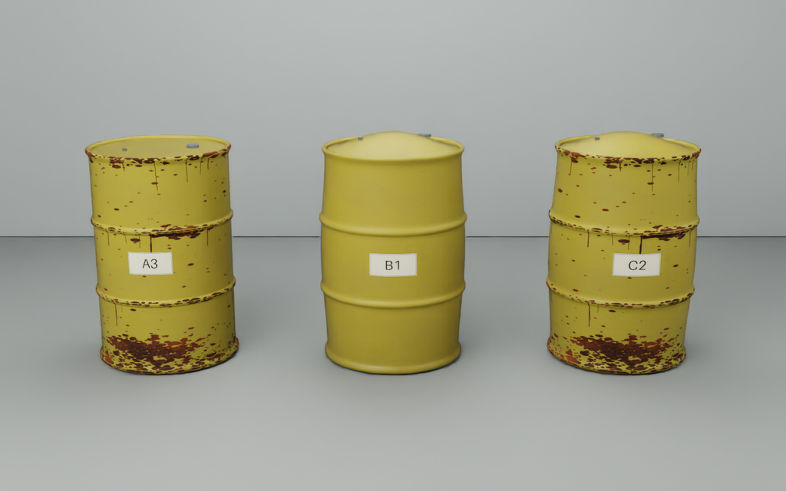

# Technical handoff: Isaac Sim barrel design

## 1. Start here

**Deliverable:** reproduce and extend the three reviewed painted-steel barrels,
including surface corrosion, independent bulging, and the repository's existing
warning plates. The preview is implemented and rendered. Promoting its new
appearance into the 28-drum hall and training pipeline is a separate integration
step described below.

Repository: <https://github.com/tika/agentverse26>

The golden render/code baseline is commit **7035539**. This handoff was checked
against the subsequently merged **cac8eed**, which adds sensor fixtures without
changing the barrel design. Record your own `git rev-parse HEAD` with captures;
seed alone cannot reproduce changes made to the source or texture generator.



| Display ID | Stable internal ID | USD root in preview | Geometry | Surface |
| --- | --- | --- | --- | --- |
| A03 | D03 | `/World/NormalRusted` | Nominal | Weathered paint + corrosion |
| B01 | D05 | `/World/BulgedClean` | Swollen body + domed lid | Weathered paint, no corrosion mesh |
| C02 | D10 | `/World/BulgedRusted` | Same deformation as B01 | Same corrosion field as A03 |

“Clean” here means no external corrosion mesh. It still has aged paint and small
grey handling marks. Rust and bulging are independent visual switches. All three
preview barrels use the same faded-yellow finish for comparison. The normal
hall's category/paint allocation and coordinates remain unchanged.

## 2. Exact reproduction

### Modal: no local Isaac installation required

From the repository root, with Python 3.12+:

```sh
python3 -m venv .venv
source .venv/bin/activate
python -m pip install -r tools/requirements.txt
modal setup
python -m unittest discover -s sim/tests -v

# One GPU, all five views in one Isaac process:
python tools/run_barrel_preview.py

# Four independent GPU workers, splitting the five views:
python tools/run_barrel_parallel.py
```

Skip `modal setup` when already authenticated to the correct team workspace.
The runner uploads the current checkout's `sim/` source and generated texture
bank. It requests RTX-capable NVIDIA hardware, captures headlessly, downloads
outputs, closes Isaac and releases its own GPU workers. No GUI/noVNC is required.
Do not run both capture commands simultaneously into the same output directory.

### Local Isaac Sim

Verified NVIDIA image: `nvcr.io/nvidia/isaac-sim:6.2.0`.
The installation used for the golden renders reported
`6.2.0-rc.14+release.52805.02189a84.gl` and driver 610.57.04.
Use a compatible RTX-capable NVIDIA GPU and Isaac's bundled Python on Linux.

```sh
cd /path/to/agentverse26
/path/to/isaac-sim/python.sh sim/render_barrel_preview.py --allow-root
```

Omit `--allow-root` for a non-root process. Ordinary system Python cannot run the
Isaac entry point. NumPy/Pillow tests can run with system Python after installing
the requirements. For a normal local run, leave `ISAAC_VIEW_SHARD` and
`ISAAC_VIEW_SHARDS` unset; they are worker-internal view-selection controls.

To inspect a saved scene, open **`sim/scene_barrel_preview.usda`** in Isaac Sim.
Copy the whole repository, or at least the entire `sim/` directory, rather than
copying the USD file alone. Texture paths are relative to that directory.
The barrel preview needs no external scene asset downloads. The separate Spot
and full-hall entry points have their own asset requirements.

The four-worker capture exports the scene from worker 0. It contains all three
barrels, but only worker 0's review cameras. The combined report records all five
camera poses. A single-worker rebuild authors all five review cameras in one USD.

### Expected output

```text
sim/scene_barrel_preview.usda
sim/out/barrel_preview/
  rust_barrel/rgb_0000.png
  normal_vs_bulged/rgb_0000.png
  bulged_clean/rgb_0000.png
  bulged_rusted/rgb_0000.png
  bulged_lid/rgb_0000.png
  report.json
  gpu_runtime.json
  shard_00/ ... shard_03/       # four-worker runs only
```

Raw captures/logs under `sim/out/` are Git-ignored. Reviewed PNGs and reports are
checked in under [previews/barrel_v2/](previews/barrel_v2/README.md).

The preview does **not** rewrite `drums.json`. Its roots are presentation copies
of inventory entries, moved into a small studio scene. Use
`sim/scene_environment.usda` / `build_environment.py` for the existing full hall.

## 3. Files and responsibilities

| File | Responsibility |
| --- | --- |
| `sim/render_barrel_preview.py` | Complete executable assembly: studio, three variants, material overrides, plate placement, cameras, capture and metadata |
| `sim/corrosion_preview.py` | `weathered_maps()`, `swollen_profile()`, `build_oxide()` and `dome_lid()` |
| `sim/profiles.py` | Nominal LLW/ILW radial profiles; `radius_at()` and 64-segment revolved mesh generator |
| `sim/drums.py` | Inventory, nominal drum hardware, shared `create_drum()` / `create_plate()` and existing full-hall fault API |
| `sim/drum_textures.py` | Shared paint/stainless banks and canonical `plate_texture()` warning-plate artwork |
| `sim/geometry.py` | USD meshes, topology, face-varying UVs and material binding |
| `sim/materials.py` | `UsdPreviewSurface` material graph and relative texture references |
| `sim/textures.py` | Seeded noise, texture-map writing and text rasterisation |
| `sim/capture_hall.py` | Camera/product setup and single-pass multi-view BasicWriter capture |
| `tools/run_hall.py` | Shared Modal image, GPU allocation, worker subprocess, logs and artifact download |
| `tools/run_barrel_parallel.py` | Four separate one-GPU workers and view/result merging |
| `tools/validate_barrel_preview.py` | Fixture-specific detection of missing yellow barrel surfaces |
| `sim/pressure_screen.py` | Separate deterministic shape + surface-temperature screening helper |

Use the installed APIs used by these files: `isaacsim.SimulationApp`,
`isaacsim.core.experimental.utils.stage`, `pxr.UsdGeom` / `UsdShade` / `UsdLux`,
and `omni.replicator.core`. Launch `SimulationApp` before importing Isaac runtime
modules. Keep barrel logic in Python builders; avoid making the saved USD the
only copy of an edit.

## 4. Geometry specification

All dimensions are **metres**. The scene is **Z-up**. Each barrel's local origin
is its centre on the floor. Preview roots are at X = −0.95, 0 and +0.95, Y = 0,
yaw = 0. The floor's upper surface is slightly below Z = 0.

### Nominal painted LLW barrel

| Property | Value / implementation |
| --- | --- |
| Nominal outer diameter | 0.598 m (23.5 in, 55 US gal / 208 L drum), including chimes and hoops |
| Nominal overall height | 0.880 m |
| Cylindrical shell radius | 0.287 m (574 mm shell); the proud chimes reach 0.299 m |
| Rolling hoops | Around one-third and two-thirds of height; radius/shape in `drum_profile('LLW')` |
| Body | Revolved profile, 64 angular segments, smooth face-varying normals |
| Body UV | U = angle / 2π; V = height / 0.88 |
| Nominal lid | Radius 0.278 m; upper surface at Z = 0.865 m, recessed 15 mm below the top |
| Hardware | Separate large/small bung meshes, retained from `create_drum()` |

The profile contains deliberate non-monotonic sections around chimes and the
inner lip. Use the existing profile and `radius_at()` rather than substituting
a simple cylinder when positioning labels or corrosion.

### Bulged variants

`swollen_profile(fraction=0.08)` densifies profile segments to at most 15 mm in Z
and applies this smooth local radial field:

```text
r_new(z) = r_nominal(z) × [1 + 0.08 × sin²(πz / 0.88)]
```

The 8% value is the peak **local scale factor**, not an 8% change to the nominal
maximum diameter. Current maximum radius is approximately 0.3151114 m:

```text
nominal maximum diameter = 0.5980000 m
bulged maximum diameter ≈ 0.6302227 m
maximum-diameter increase ≈ 5.39%
```

`dome_lid(rise=0.070)` creates a separate lid with 14 radial bands and 96 angular
segments:

```text
z_lid(r) = 0.865 + 0.070 × [1 − (r / 0.278)²]^1.5
```

The dome centre is Z = **0.935 m**: 70 mm above the nominal recessed lid and
55 mm above the nominal top chime. Bung centres are raised by the same dome
function at their radial positions. B01 and C02 use identical deformation.

This is authored geometry for an observable condition cue. There is no shell
stress calculation, internal gas state, pressure-to-deformation calibration,
rupture simulation or mass/volume conservation. The exaggerated dome was chosen
for the review and must not be described as measured gas buildup.

### Hierarchy

```text
/World
  /NormalRusted
    /Body
    /Lid
    /BungLarge
    /BungSmall
    /Plate
    /SurfaceCorrosion
  /BulgedClean
    /Body, /Lid, /BungLarge, /BungSmall, /Plate
  /BulgedRusted
    /Body, /Lid, /BungLarge, /BungSmall, /Plate
    /SurfaceCorrosion
  /Hall/Materials/...
  /ReviewCameras/...
```

`/World/Hall/Materials` is the shared material-helper path even in the studio
preview. It does not mean the full hall was built there.

## 5. Rust and paint design

The reviewed direction is **thin coating loss and oxidation**, concentrated
where water/damage might collect, with small scattered defects and downward
staining. Rust remains independent from the painted barrel body.

`weathered_maps(seed=74)` returns `(paint_maps, oxide_maps, alpha_array)`.
All maps are procedural 1024×1024 PNGs under `sim/assets/generated/`.
The current prefix is `preview_weathered_yellow_s74_v2`.

| Layer | Implementation |
| --- | --- |
| Paint | Base RGB approximately (170,153,66), broad variation, grey scratches and darker base grime; no orange oxide baked into paint |
| Paint finish | Roughness roughly 0.35–0.65; fine normal detail; nonmetallic painted surface |
| Corrosion mask | Seeded chips weighted toward bottom/top chimes and rolling hoops, plus a few denser local failures and sparse downward streaks |
| Oxide colours | Dark brown (58,38,25), red-brown (116,65,34), restrained fresh-edge orange (155,91,42) |
| Oxide finish | Roughness about 0.87–0.97, fine normal variation and a grayscale opacity map |
| Geometry | A 256×144 cylindrical cell grid; cells are emitted only where mask alpha reaches 0.17 |
| Surface offset | 0.00035 m beyond the chosen local profile radius |
| Cutout | `UsdPreviewSurface.opacityThreshold = 0.17`; opacity samples the grayscale image's **red channel**, not an absent alpha channel |

The oxide follows the nominal or swollen profile, so it stays attached to hoops
and the deformed surface. A03 and C02 share the same field/seed for comparison.
Body and lid currently share the weathered-paint material in this preview;
only the outer cylindrical surface gets the separate oxide mesh.

Normal maps approximate fine surface relief. Their values are not calibrated
physical pit depth. Do not use their apparent shading to claim wall loss.

**Important:** `weathered_maps()` currently regenerates its files every call;
it has no early cache-return branch. Other generators, especially
`plate_texture()`, do cache by filename. A live renderer may retain texture
contents: restart/reload or bump the version suffix when revising artwork.

## 6. Label design and identity contract

**Reuse `plate_texture(entry)` and `create_plate(stage, entry, profile)` directly.**
The design is shared with the main scene and Cosmos plate reader:

- Yellow background, black border and radiation trefoil.
- LLW/ILW category, large row/slot ID, “WASTE PACKAGE” and barcode pattern.
- Row A–D plus zero-padded slot 01–07: **A03**, **B01**, **C02**.
- Stable inventory identities remain **D03**, **D05**, **D10**.

The artwork is 512×358 px. The curved plate spans approximately 0.20×0.14 m,
is centred at 60% of nominal height (Z = 0.528 m here), and sits 2 mm beyond
the local profile. The plate mesh samples profile knots to avoid hoop clipping.

The studio calls `create_plate()` with a temporary `row='A'` copy to face every
plate toward the review camera. **Do not carry that override into the hall.**
Hall plates must face their actual row's aisle, independent of body yaw.

`display_id` is derived from actual row/slot inventory allocation. Do not invent
random IDs, remove leading zeroes or replace the warning plate with a plain text
tag. The barcode is decorative simulation artwork, not an encoded inventory API.

The plate cache filename uses internal ID/category/version, not `display_id`.
If intentionally changing an existing ID's artwork, regenerate that cached file
or bump its version. Keep `drums.json`, printed ID, semantic internal ID and
reader association consistent. Never expose simulator identity to the reader
as though the camera had recognised it.

## 7. Parameters to change safely

There is no preview command-line `--seed`, `--rust` or `--bulge` option today.
Edit the named Python parameters/variant list, then rebuild.

| Change | Where | Coupled edits / check |
| --- | --- | --- |
| Rust/paint seed | `weathered_maps(seed=74)` | Update reported seed too; keep A03/C02 aligned if comparing shape |
| Rust distribution/colour | `weathered_maps()` | Preserve separate paint/oxide channels; regenerate maps; inspect at the intended distance |
| Rust present/absent | `rusty` in the variant list | Controls whether `build_oxide()` is called |
| Body swelling | `swollen_profile(fraction=0.08)` | Update metadata's swelling value and measured maximum-radius calculation |
| Lid rise | `dome_lid(rise=0.070)` | Also change the renderer's bung-lift constant and reported lid rise |
| Plate | Shared generator / inventory `display_id` | Preserve category, stable ID, zero padding and row-facing orientation |
| Camera | `views` in `render_barrel_preview.py` | Adjust the fixture validator if framing changes; inspect all geometry |
| Paint colour/count/layout | Variant assembly | The current yellow-region validator will need a suitable replacement |

The v2 corrosion and dome functions hardcode LLW dimensions (0.88 m / 0.278 m).
They are **not generic ILW builders**. Parameterise dimensions and develop a
separate stainless corrosion appearance before applying them to 500 L ILW drums.

## 8. Rendering and acceptance

Capture uses `RayTracedLighting` through the verified Isaac real-time pipeline,
not a high-sample offline render. The runtime may report its real-time mode as
`RealTimePathTracing`. RTX Minimal produced black RGB in earlier tests.

Studio settings: ISO 200, f/4, 1/60 s, automatic exposure disabled; grey floor
and backdrop; three area lights (1800 / 1000 / 1400 intensity) plus dome fill 160.
Screenshots are 1024×640, with 36×22.5 mm camera apertures; focal lengths are
49 mm, except the lid detail at 56 mm. Exact poses are in the script and report.
Hide both `/app/viewport/grid/enabled` and
`/app/viewport/defaults/guide/grid/visible` before warm-up/capture.

A manually opened USD uses the viewer's own exposure/render settings. Use the
capture script for reproducible pictures; opening the file alone is not a
reproduction of the saved screenshot's tone mapping.

The verified parallel run used **four independent L40S workers**, each with one
active GPU. Five views are split by index modulo four and merged locally. Its
recorded wall time was **178.6 s**, including setup/collection. This is not a
controlled speedup benchmark against a matched single-GPU machine.

A **single Isaac process with four GPUs** was also tried. All four activated,
but two painted barrel surfaces disappeared. That output was rejected. Prefer
`run_barrel_parallel.py`; do not treat a GPU allocation or exit code as image QA.

Acceptance checklist:

1. All three complete bodies and their lids/bungs are visible in the comparison.
2. A03 is nominal/rusted; B01 is bulged without rust; C02 is bulged/rusted.
3. Both bulged barrels have the same shape. Rust remains attached to the surface.
4. The correct yellow warning plates are readable and not buried in the body.
5. No grid/axes, black images, missing surfaces or obsolete white text tags.
6. `report.json` matches the selected variants; each worker log and active-GPU
   count is present; workers stop after collection.

`validate_barrel_preview.py` checks yellow coverage in three known image regions.
It caught the missing-surface failure. It is deliberately fixture-specific and
cannot validate arbitrary colours, counts, layouts, rust realism or labels.
Changing the fixture requires a revised check, not blindly lowering thresholds.

## 9. Integration into the hall and YOLO pipeline: work still required

The full hall currently uses the earlier `defects.py` corrosion system. The new
preview does not automatically flow through `set_drum_faults()` or
`set_drum_state()`, and it does not update their ground-truth inventory fields.

Before replacing the hall design:

1. Extract a reusable barrel-appearance builder with explicit dimensions, seed,
   rust, body-swelling and lid-rise parameters. Keep independent switches.
2. Preserve the hall's exact XY/yaw, category, internal ID and `display_id`.
   Use its real row when recreating the plate.
3. Reapply collision geometry after replacing a Body. `create_drum()` authors
   static collision on its original Body, but this preview's replacement bulged
   mesh does not reapply that API. Do not hand it to navigation as verified
   collision geometry without that integration.
4. Put corrosion features under `/World/Defects/Dxx/...`, separate from the drum.
   Give them `class=corrosion` and `drum_id=Dxx` using the installed label API.
   Keep the barrel class `drum` and add no separate bulge class.
5. Split spatial corrosion clusters into suitable feature meshes/annotations.
   `build_oxide()` currently creates **one mesh of disconnected chips across the
   barrel**. Labelling that entire mesh can yield an oversized box. Also, leaving
   it under a root inheriting `class=drum` would mislabel it. The preview is not
   a validated YOLO annotation asset as-is.
6. Keep inventory `radius`/`height` nominal; record actual max radius, lid rise,
   faults/severity and defect paths separately in `shape`/`defects`. Rebuild or
   clear old meshes when the state changes. The preview's detail report is not
   a replacement for `drums.json`.
7. Preserve simulator-only gamma/payload metadata while replacing geometry.
   Do not derive source strength, heat or gas automatically from visual rust.
8. Re-run seeded rebuild checks, full-hall camera/depth captures and true
   Replicator class/ID box proof. Include clean controls and independent rust/
   bulge combinations before bulk synthetic-data generation.

The mask's UV occupancy is not measured visible rust percentage or metric
surface area. Depth/segmentation measurements and camera visibility are needed
for runtime condition estimates. Keep authored truth out of model inputs.

## 10. Temperature + bulge screening interface

The separate helper is available for an integration owner:

```python
from pressure_screen import screen_pressure_risk

result = screen_pressure_risk(
    bulge_pct=5.37,                 # runtime geometry estimate, not mesh truth
    lid_rise_mm=70.0,               # runtime estimate
    surface_temperatures_c=[29.9, 30.0, 30.1],
    ambient_c=18.0,
)
```

These example numbers are synthetic. Current policy takes a median of up to
five surface readings. A shape trigger (≥2% diameter increase or ≥20 mm lid rise)
and surface temperature ≥5 °C over ambient produce `suspected_pressurisation`.
Shape-only and heat-only findings still receive separate inspection actions.
Every output has `gas_confirmed=false`. These are demo settings in
`inspection_config.json`, not operational safety limits.

The helper does not read heat from RGB, calculate gas chemistry or simulate an
IR camera. The merged repository also contains `inspection_payloads.py` with
synthetic thermal/gas fixtures; those remain independently authored inputs, and
are not automatically connected to this preview. Respect occlusion, timestamps
and measurement quality when wiring observations to the planner.

See [barrel review/screening notes](barrel_appearance_review.md),
[sensor implementation plan](sensor_implementation_plan.md) and
[inspection source register](inspection_source_register.md) for context.

## 11. Handoff completion criteria

The next person should first reproduce the checked-in comparison without
editing the design. Then make one change at a time and supply:

- Source commit, explicit seed/parameters, chosen label/internal-ID mapping.
- Complete three-variant comparison and readable label/lid details.
- USD with relative texture paths, generated assets and machine-readable report.
- For hall integration: updated inventory, collision verification and actual
  class/ID annotations, not only a visually plausible screenshot.
- Exact command and GPU topology used, timings, limitations and confirmation
  that owned GPU workers were stopped.

Use normal Git commits and merges to preserve parallel team work; do not reset,
clean or force-push to synchronise. Keep raw frame dumps out of Git and commit
the source, necessary small texture assets and selected review artifacts.
