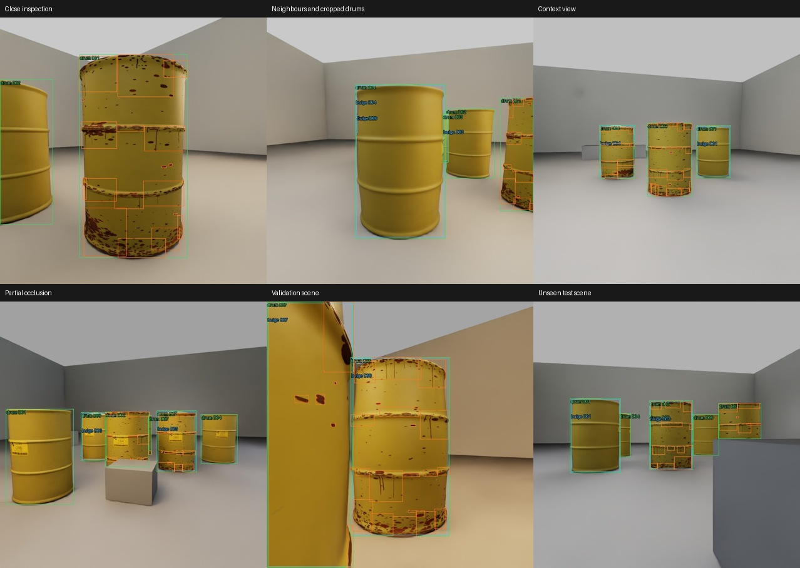

# Completed dataset: barrels_v2_1200

Completed 7 November 2026 in Modal workspace **paramsachdeva07**, environment main.
The dataset is generated and verified. **No model training was started.**

| Item | Result |
| --- | --- |
| Images | **1,200**, each 640×640 RGB |
| Splits | **900 training / 150 validation / 150 test** |
| Scenes | 61 independent seeds, held together within splits |
| Views | 720 close inspection / 480 context |
| Scene sizes | 19 scenes with 4 drums, 18 with 6, 24 with 8 |
| Annotation classes | 0 drum, 1 corrosion, 2 bulge |
| Boxes | 5,029 drum / 26,224 corrosion patch / 2,518 bulge |
| Hardware | Up to **10 concurrent RTX PRO 6000 Blackwell Server Edition** workers, observed peak 10 |
| Final render pass | **21 min 36 s**, including startup, scene building, rendering and download |
| Remote verification | **3,600 image/label/metadata files SHA-256 verified** |
| Dataset size | 72,000,508 bytes; ZIP 59,307,329 bytes |

Generation, upload and verification for the successful run finished in about
27 minutes. The render timing above excludes earlier failed/debug attempts,
which remain preserved separately. The final run completed all 61 scenes without
worker failures. GPU containers were released before the CPU upload/verification
stage; no render GPU remains running.

## Exact locations

- **Modal dataset:** `detector-data:/releases/barrels_v2_1200/`
- **Modal ZIP:** `detector-data:/archives/barrels_v2_1200.zip`
- **Modal validation report:** `detector-data:/reports/barrels_v2_1200_validation.json`
- **Local dataset:** `out/detector_releases/barrels_v2_1200/`
- **Local ZIP:** `out/detector_releases/barrels_v2_1200.zip`
- **Raw frames, native annotations, per-worker logs:** `out/detector_pilot/20261107T214634Z_a02466/`
- **Raw Modal run:** `detector-data:/pilots/20261107T214634Z_a02466/`

```text
barrels_v2_1200/
  data.yaml
  manifest.json
  generation.json
  images/{train,val,test}/seed_NNNN_frame_NNN.jpg
  labels/{train,val,test}/seed_NNNN_frame_NNN.txt
  metadata/{train,val,test}/seed_NNNN_frame_NNN.json
```

Each label row is `class x_center y_center width height`, normalised to 0–1.
Raw training JPGs have no drawn boxes. Annotated review JPGs are separate.
`data.yaml` uses relative directories so the dataset can be moved or mounted.
For later training, pass the absolute path to that YAML on the training machine.
Source hashes, frozen plan, generator commit and workspace are in the manifest.

```sh
# From the correct Modal profile; downloads allocate no GPU:
modal volume get detector-data /archives/barrels_v2_1200.zip out/barrels_v2_1200_download.zip
```

No second-account generation or merge is required. The publisher combined the
61 scene outputs in the owner's workspace and preserved split assignments.
The launcher now detects an existing named release before scheduling GPUs, so
repeating its command will report the existing release rather than regenerate it.

## Appearance and diversity

The approved painted LLW designs remain the basis: healthy weathered paint,
realistic thin chipped corrosion, mildly bulged clean barrels and bulged rusty
barrels. Current nominal size is 598 mm diameter × 880 mm high. Bulging varies
7–9% in peak local radial scaling, with 65–75 mm lid rise above the recessed lid.
No severity classes, pressure simulation or confirmed gas measurements are implied.

Printed A01–D07 warning plates and rust patterns are seeded independently of
faults. Lights, colour temperature, room palettes, layout, camera bearing,
distance, height, clutter and partial occlusion vary. Close views may contain
neighbours; there is no fixed number of detections expected per image.

Labelled geometry stays continuously visible in USD. Camera centre rays and
camera positions are checked against neighbouring drums. Cropped boxes remain
valid during preview drawing. These changes corrected the earlier annotation-ID,
preview drawing and camera-clearance failures before the accepted run.



[100-image overview](previews/barrels_v2_1200/contact_sheet.jpg) ·
[Machine-readable audit and upload receipt](validation/barrels_v2_1200.json) ·
[Complete generation/recovery handoff](dataset_generation_handoff.md)

## Checks and limits

The publisher checked frame completeness, image resolution, camera calibration,
YOLO/native metadata agreement, label bounds/classes, visible drum association,
inspection-target presence, duplicate images, split class coverage and rust seeds
crossing split boundaries. All checks passed, then every uploaded dataset record
was read back and hash-verified. The contact sheet and selected close/context
views were visually reviewed.

The dataset covers painted LLW studio barrels. Stainless ILW appearance,
full-hall deployment and real-camera accuracy have not been validated. These are
dataset-integrity checks, not detector accuracy results. Training, threshold
selection and held-out model evaluation remain separate authorized steps.

Source run commit: `8e62bcff5010983bd3a640630e4c8c8d19180a62`.
The current `detector-training` branch includes the generator, frozen plan,
publication/recovery tools, fixes and this audit; raw bulk data stays outside Git.
