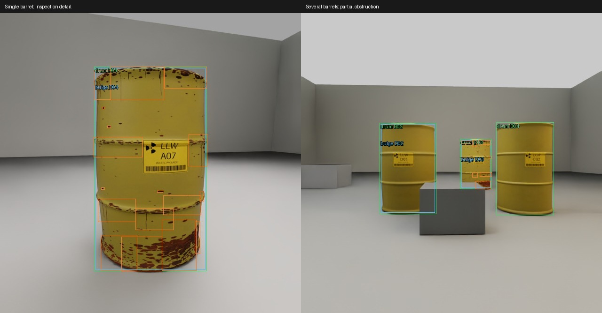

# Diverse barrel capture: 40-image validation

Run `20261107T201606Z`, 7 November 2026, branch `detector-training`.
**Only 40 images were generated. No 1,500-image run or model training started.**

## Why more than one barrel can appear

One image is one training sample; its label file contains a row for each visible
object or defect region. An object detector learns variable object counts.
Single-barrel views provide larger defect detail, while multi-barrel views teach
association, crowding and partial visibility. Using only isolated barrels would
leave a gap between training and the hall's camera images. The training image mix
does not change the hall's object count or itself add simulator rendering cost.
Inference accuracy and frame rate still need measurement after training.

## Implemented variation

- **24 single-barrel inspection frames**, explicitly hiding all other drums and
  their corrosion roots. Native-box assertions require exactly one intended drum.
- **16 context frames**, requiring at least two visible drums, with a low
  foreground crate on eight frames. Every visible drum is annotated.
- Front, back and side bearings with jitter; random distance and camera height.
  Calibration stays 640×640, focal length 22.5 mm and 36 mm aperture (77.3° FOV).
  Single distance 1.0–1.5 m; context distance 2.8–3.7 m; height 0.45–0.8 m.
- Random row, staggered or cluster layout, rotation and position jitter.
- Four floor/wall colour palettes and variable floor roughness.
- Light direction, power, size and colour temperature (3900–6900 K), plus
  per-frame strength variation and background crates independent of faults.
- Independent printed A01–D07 IDs and rust fields; mild 7–9% peak local radial
  bulge and 65–75 mm lid-rise variation. The approved materials/shape remain the
  basis; these are not severity labels or evidence of measured gas pressure.
- One camera/render product is reused, changing pose, visibility and lighting
  between frames rather than constructing five simultaneous cameras.

Corrosion annotation groups neighbouring **visible** chip boxes on the same drum
into bounded local patches. The rule limits gap distance, box span and empty
area; different drums cannot merge. Small-box filtering follows grouping. This
does not change the realistic oxide geometry. On identical v1 images, the new
annotation policy reduces corrosion boxes from 1,970 to 773. The new views have
different scale/visibility, so their counts are not a controlled comparison.

[All 40 annotated images](previews/detector_diversity40/contact_sheet.jpg) ·
[Validation JSON](validation/detector_diversity40.json)

## Verification and timing

- Eight distinct L40S GPUs, each one active renderer; eight successful workers.
- 40 non-black, unique images; native semantic assertions pass for 24 single
  frames and 16 context frames. Label bounds/class IDs and drum associations pass.
- 86 drum boxes, 530 corrosion patches and 45 bulge condition boxes. Bulge uses
  the visible whole-drum extent and overlaps the ordinary drum box.
- Four detector CPU tests and all ten existing simulation tests pass.
- Full contact sheet and selected close/occlusion views visually reviewed.
- All owned containers stopped after download; no full dataset job is running.

The launcher recorded **234.972 s using its monotonic timer**, while its UTC
timestamps span **283.540 s**. Both measurements are retained because the clocks
disagree; do not present this as a controlled throughput/speedup benchmark. The
per-worker timers range from 119.558–151.899 s. These include cold startup and
warm-up; final dataset throughput still needs a longer steady capture run.

## Storage and code

Local artifacts: `out/detector_pilot/20261107T201606Z/`.
Modal Volume: `detector-data:/pilots/20261107T201606Z/`.
Packaged `dataset/` contains matching `images/`, `labels/`, `metadata/` names and
a manifest with checksums, source hashes and view-mode counts. The archive is
`barrels_diversity_40.zip`. Reviewed artifacts are in Git; bulk data is ignored.
The inspected pilot has no train/validation/test split and must not be reused
as an independent test set after these appearance decisions.

Implementation: `detector/pilot_specs.py` (seeded diversity),
`detector/annotations.py` (patch grouping), `sim/detector_studio/pilot.py`
(scene/camera/visibility/capture), `detector/modal_pilot.py` (GPU scheduling and
progress). The review runner defaults to eight GPUs / 40 images; increasing its
container cap does not establish availability of 16 GPUs. Existing hall snapshots,
inventory, materials and canonical detector class mapping are unchanged.
