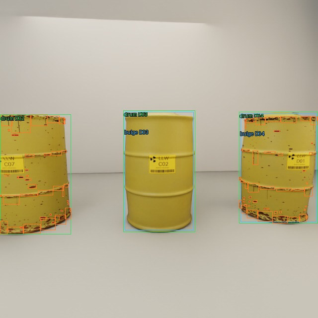

# 40-image, eight-GPU barrel pilot

Measured 7 November 2026, run `20261107T200140Z` on Modal workspace
`paramsachdeva07`. No detector was trained and no full 1,500-image job started.

## Measured result

| Item | Result |
| --- | --- |
| Completed images | 40, all 640×640 |
| Workers | Eight independent, distinct L40S GPUs; one active GPU per worker |
| Successful launcher wall time | **213.747 s (3 min 34 s)** |
| Dispatch through download | 202.822 s |
| Individual worker time | 123.317–187.516 s |
| Sum of worker time | 20.919 GPU-minutes; not a billing statement |
| First attempted launch to successful completion | 275.694 s (4 min 36 s) |
| Successful-run worker failures | Zero |
| Annotated boxes | 140 drum, 1,970 corrosion, 68 bulge |
| Very small boxes excluded | 2,094 boxes with width or height below 2 pixels |

The first launch had a Python module-packaging failure before Isaac started;
the launcher dependency was corrected. The main wall time includes the successful
image build, allocation, Isaac startup, geometry generation, camera warm-up,
capture, annotation checks and artifact download. It excludes code authoring,
later human review, ZIP packaging and the subsequent packaged-dataset upload.

Isaac startup plus geometry generation took 56.6–71.2 s per worker. Camera setup
and warm-up took another 59.3–105.0 s. The final single-frame capture/export after
warm-up took 0.81–2.49 s for five simultaneously attached cameras. That last
number is **not** end-to-end image throughput. Do not linearly extrapolate this
pilot to a 1,500-image run or claim an eightfold GPU speedup without a control.

## Assets and checks

Each seed has four LLW drums: normal clean, normal rusted, bulged clean and
bulged rusted, randomly permuted. Printed warning-plate IDs are sampled from
A01–D07 independently of conditions; 20 different printed IDs occurred across
this pilot. Each drum has a separate rust seed; rust maps and occupied geometry
are shifted together around the circumference. Independent rust/bulge toggles
preserve the reviewed appearance. Peak local radial factors ranged from
7.10–8.94%; lid rises ranged from 65.19–74.39 mm above the recessed nominal lid.
These are not severity classes or measurements of gas pressure.

The detector classes are exactly `0 drum`, `1 corrosion`, `2 bulge`.
Bulge annotations cover the entire visible deformed drum and overlap the drum
annotation. Native Replicator boxes provide the observed extents. Corrosion is
separate conforming geometry, grouped into adjacent spatial chip clusters.

Automated checks verified non-black RGB, resolution, valid YOLO class IDs and
normalised boxes, presence of all three classes per worker, eight distinct GPU
UUIDs and successful worker exits. The full contact sheet and selected close
views were visually checked for missing bodies, wrong plates and misplaced
boxes. All owned containers were released; `modal container list --json`
returned an empty list after completion.



[All 40 annotated previews](previews/detector_pilot40/contact_sheet.jpg) ·
[Machine-readable validation/timing](validation/detector_pilot40.json)

## Storage and reproduction

- Local: `out/detector_pilot/20261107T200140Z/`.
- Modal Volume: `detector-data`, `/pilots/20261107T200140Z/`.
- Raw seed directories: RGB/native boxes/labels, annotated JPGs, metadata,
  per-worker progress, runtime reports and logs.
- Packaged data: `dataset/images`, `dataset/labels`, `dataset/metadata`, with
  matching `seed_XX_frame_XXX` names and a SHA-256 manifest.
- Downloadable archive: `barrels_pilot_40.zip` (1,743,660 bytes).
- Aggregate artifacts: `timing.json`, `validation.json`, `contact_sheet.jpg`.

No training split is assigned to the inspected pilot. Keep it separate from the
eventual independent test set. Bulk data remains outside Git; source and selected
review artifacts are committed on `detector-training`.

```sh
python3 detector/modal_pilot.py
python3 detector/status.py RUN_ID
python3 detector/package_pilot.py out/detector_pilot/RUN_ID
python3 -m unittest detector.test_pilot -v
python3 -m unittest discover -s sim/tests -v
```

Both new CPU tests and all ten existing simulation tests passed.

## Before the full dataset

The pilot has 24 broad row views and 16 closer views, against one studio
background. Increase angle, background and room-layout variation for production.
There are many tiny corrosion clusters; review whether nearby chips should be
merged into more useful inspection regions rather than letting small boxes
dominate training. The present pilot does not establish detector accuracy.
Benchmark a camera-reuse capture loop before estimating bulk throughput; retain
eight independent workers, seeded split isolation and durable progress.
