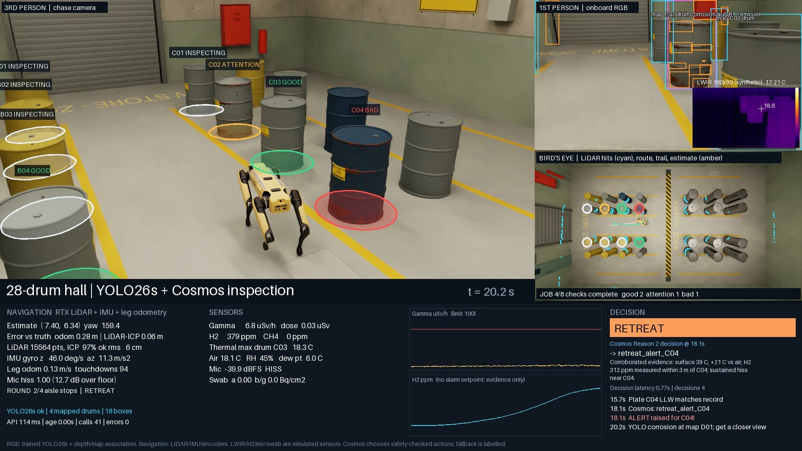

# Integrated 28-drum hall recording — 8 November 2026

The completed recording uses the reviewed barrel designs, walking Spot, the
trained YOLO26s API and the teammate's live Cosmos endpoint. Reproduce it using
[the integration guide](yolo_cosmos_integration.md). No training was performed.



## Recording and outputs

- Local MP4: `out/recordings/agentverse26_full_sim_yolo_cosmos.mp4`.
- Run directory: `out/hot/001937-agent_yolo_round-3730/`.
- Format: H.264, yuv420p, 1920×1080, 12 fps, 35 seconds, silent, fast-start MP4.
- Runtime: 136.34 seconds executing the mission; 162.5 seconds including encode
  and download, on the already-warm RTX PRO 6000 Isaac worker.
- Overlay: chase view, onboard RGB boxes, synthetic thermal view, full-hall map,
  LiDAR/odometry diagnostics, gamma/dose, H2/CH4, air/RH/dew point, microphone,
  swab, sensor histories, actual Cosmos action/reason/latency and events.
- The simulation worker was stopped after download. The deployed detector API
  remains available and scales to zero when idle.

The video and accompanying reports, decisions, inspection memory, telemetry,
timings and detector requests are bundled on Modal volume `detector-models` in
the owner's `paramsachdeva07` workspace:

```sh
modal volume get detector-models \
  /mission_runs/mission_20261108_yolo_cosmos.tar.gz \
  ./mission_20261108_yolo_cosmos.tar.gz
tar -xzf mission_20261108_yolo_cosmos.tar.gz
```

Use a Modal profile with access to that workspace. Credentials are not included
in the archive or repository. The full model remains in its existing run path;
see [the model API guide](model_api.md).

## Observed result

All 64 detector requests succeeded, with a median request wall time of 115.3 ms.
They used run `yolo26s_20261107T225757Z_d625ef`, best checkpoint SHA-256
`63dc5dfd9933aff58bc0cfc5a759de4b78ef9f25b6c7b74f3f818bceb72e6f04`.
All four recorded action decisions came from live Cosmos, with no rules fallback:

| Simulation time | Selected action |
|---|---|
| 0.00 s | Inspect C02 |
| 4.12 s | Swab C02 |
| 14.62 s | Inspect C04 |
| 18.14 s | Retreat and alert on C04 |

Spot walked 8.73 m and remained upright. H2 peaked at 392 ppm and gamma at
10.1 µSv/h. Its required ID, thermal and visual checks were collected for the
eight-drum LLW job: four good, three attention, one bad. C04 raised the alert,
and the robot retreated and stopped. This is an eight-drum job inside a 28-drum
hall; it does not claim inspection of all 28 drums.

[Machine-readable validation and source hashes](validation/mission_20261108_yolo_cosmos.json)
and [the full inspection report](validation/mission_20261108_report.json) are
included in Git. The raw video and larger logs stay outside Git.

## Interpretation limits

The recording retains actual detector false positives, including uncorroborated
rust/bulge findings on other drums. These are prototype findings rather than
confirmed physical faults. Thermal, gamma, gas, microphone and swab are simulated
sensor channels. A swab measures contamination; it cannot validate the drum's
structural integrity.

Cosmos's explanations are displayed verbatim and are not themselves verified
measurements. Its first explanation includes an unsupported C02 temperature
claim; another mentions retreat while selecting inspection. Grounding and
action/reason consistency checks remain future work. The sensor panel and
structured evidence are separate from that generated explanation.

Inference is synchronous and pauses advancement of the simulated clock. The
35-second video is simulation-time playback, not a real-time latency benchmark.
The MP4 was visually checked at opening, inspection, retreat and report frames;
the wall-clipping opening and roof-obscured overhead view from an earlier take
were fixed before this recording. Thirteen existing simulation tests passed.
