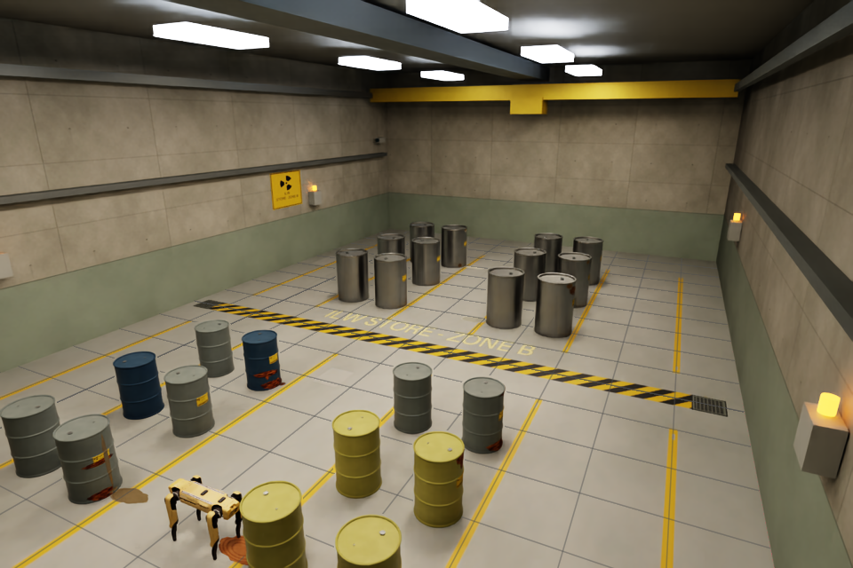
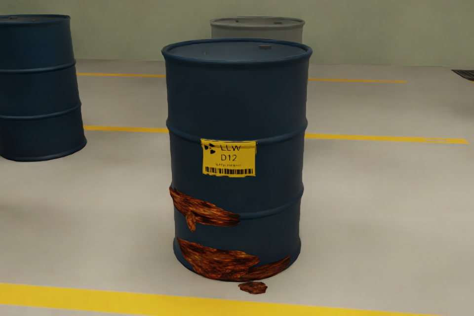
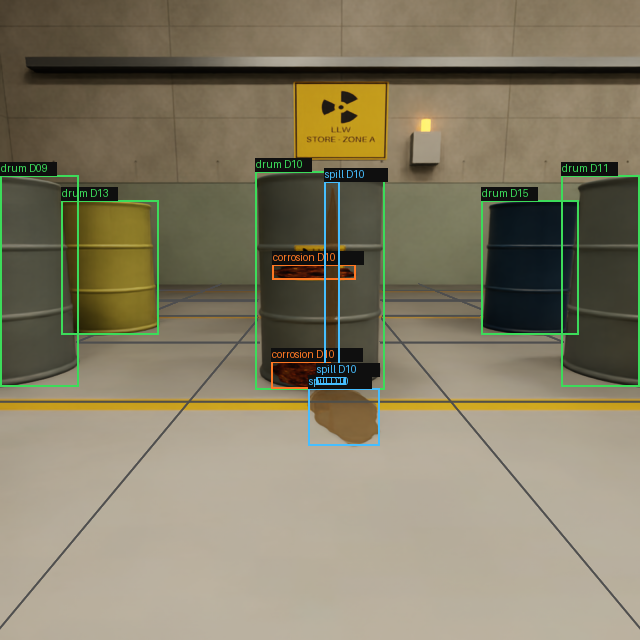
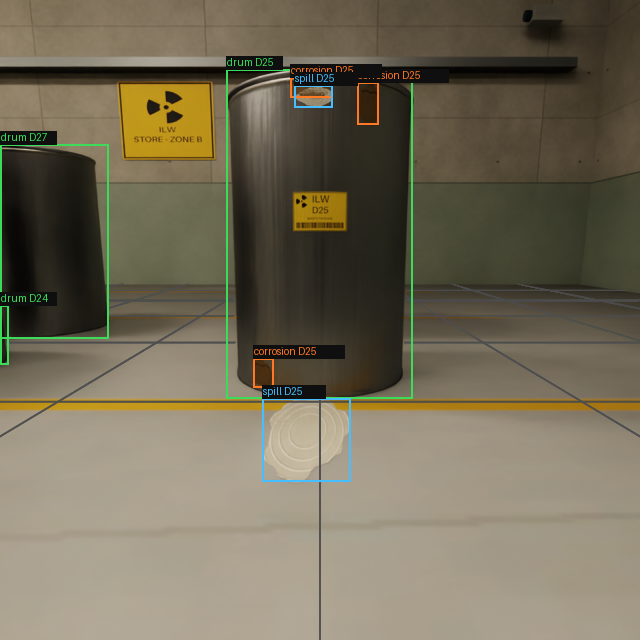

# Rendered environment previews

These are actual Isaac Sim renders from the checked-in seed-42 layout.
The environment-only scene parks Spot at the front; the presentation parks it
near D10. Spot stays stationary in this eight-second camera-tour video.

[Download/view the environment walkthrough](environment_walkthrough.mp4)

See [environment_handoff.md](../environment_handoff.md) for exact rebuild,
picture settings, limitations and capture commands. Validation reports are in
`../validation/`; raw frames and full outputs remain under the ignored `sim/out/`.
