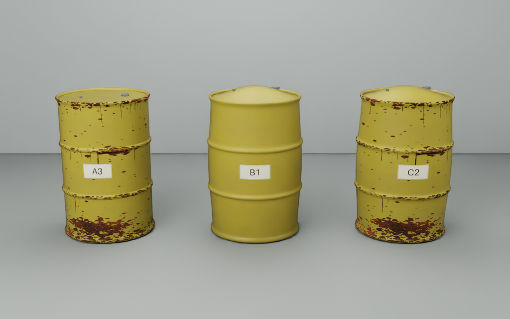
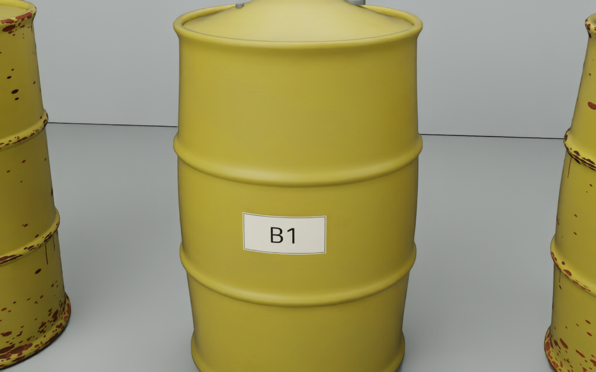
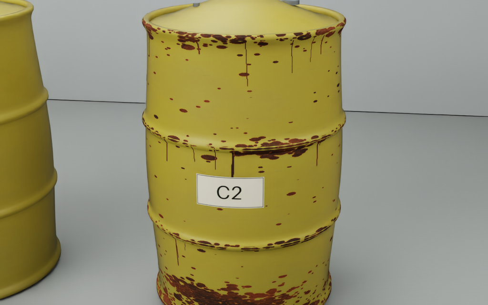

# Isolated barrel v2 review

Left to right: **A3 nominal rusted**, **B1 bulged clean**, **C2 bulged rusted**.
Bulged variants use the same deformation: 8% peak local radial scaling field
(approximately 5.37% increase in maximum diameter) and 70 mm lid rise from the
nominal recessed lid. This is a visibly amplified demonstration, not gas physics.

Actual Isaac renders; no generated-image or image-editing model was used.
The main 28-drum hall's fault appearance was not replaced by this study.
See [review notes and pressure-screen logic](../../barrel_appearance_review.md).
Run `python3 tools/run_barrel_preview.py` to rebuild and capture.
