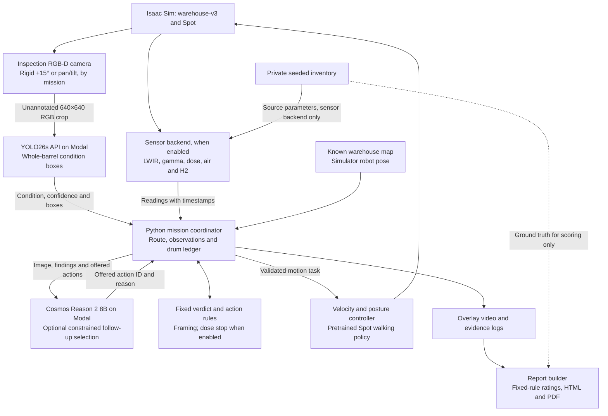

# Current CANIS architecture

Aligned with the warehouse-v3 mission scripts on main. The Python mission coordinates the models; YOLO and Cosmos do not call each other. Fixed rules set verdicts, while Cosmos can select only offered follow-up actions.

## Mission variants

- `scripts/hot/full_hall/aisle_patrol.py`: live thermal, gamma/dose, air and H2 sensor backend; rule-driven route and dose retreat; no Cosmos in this round.
- `scripts/hot/full_hall/wh_rigid_walk.py`, enabled by `wh_rigid_cosmos.py` or `wh_rigid_full_cosmos.py`: body-fixed camera, latest YOLO26s, optional Cosmos review and bounded closer looks; no live domain sensors in this implementation.
- `scripts/hot/full_hall/rigid_middle_upper.py` with `ambiguity_cosmos.py`: rigid-camera framing gate, physical body pitch, YOLO votes and constrained Cosmos recheck selection. The inspection course includes a scripted heat cue.

These variants share services and recording conventions; their features are not automatically combined. The locally recorded six-drum rust/warm-bulge prototype is a separate run and is not the implementation of every main-branch mission.

## Data and timing

- YOLO receives an unannotated 640×640 inspection-camera crop and returns whole-barrel condition boxes/confidences. The third-person presentation view is never detector input.
- Cosmos Reason 2–8B receives an image, detector/inspection state and offered actions; its action ID and reason return to the Python executor for validation. Calls occur at eligible reviews, not every physics step.
- Warehouse navigation uses public map geometry and simulator robot pose. Onboard localisation and SLAM are not implemented in these warehouse runs.
- The aisle patrol samples gamma/air/H2 every 0.5 simulated seconds. LWIR is associated with inspection views using depth and map geometry. Its dose rule runs on gamma samples.
- The main patrol/walk detector interval is at least 0.4 simulated seconds when a view is settled. Rendering is 24 frames per simulated second; physics and the walking policy use their own substeps.
- Model calls are synchronous: simulation pauses during inference. Video speed does not measure wall-clock throughput.
- Private source parameters feed the sensor backend. Authored condition truth is not passed to Cosmos as a finding; the report may use it separately for scoring.
- The report builder consumes the completed run logs/evidence. Fixed rules set ratings and missing readings remain not measured. It produces HTML/PDF and a summary.

## Source of truth

See the [README architecture and mission table](../README.md#technical-architecture), [latest YOLO model](../detector/v2/LATEST_MODEL.md), [Cosmos endpoint](cosmos_8b_api.md), [sensor backend](../sim/warehouse-v3/warehouse_sensors.py) and [report builder](../tools/full_hall_report/report/README.md).

The older `docs/architecture.png` describes an earlier hall workflow; the Mermaid diagram above is the current architecture reference.
