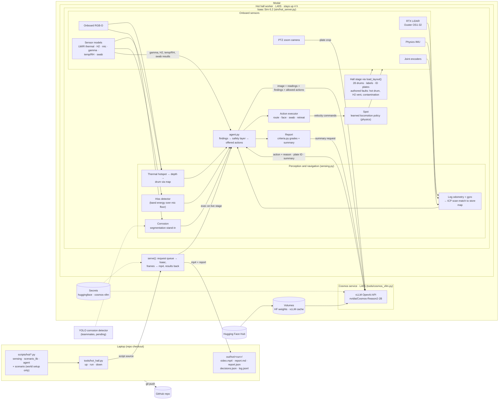

# How the inspection system fits together

The robot discovers the world through onboard sensors. Cosmos Reason 2 chooses
every action from a list the safety layer allows. The scenario script only
authors the world, for example which drum is heating. Dashed boxes are not
built yet.

## What each part is

| Part | Real or modelled |
| --- | --- |
| Hall, drums, Spot locomotion, RGB-D, PTZ, LiDAR, IMU, encoders | Isaac Sim physics and RTX rendering |
| Gamma, temperature/RH, H2, microphone, LWIR thermal, swab | Sensor models of authored sources. Isaac has no native sensor for these |
| Navigation | Real estimator on sensor data. Ground truth is used only for the error shown in the overlay |
| Thermal, hiss and ID detection | Real algorithms on sensor output. IDs are read by Cosmos from PTZ crops |
| Corrosion detection | Simulator segmentation, until the YOLO detector lands |
| Decisions | Cosmos Reason 2 over safety-checked actions. A rules baseline takes over if Cosmos is unreachable, and that is labelled in the video |
| Thresholds | `sim/inspection_config.json`. Sources and limits are in [inspection_source_register.md](inspection_source_register.md). H2 has no alarm setpoint |

`tools/run_hall.py` jobs, such as `tools/run_plates.py`, render
texture-accurate stills with the same container recipe as the hot worker.
Renders from `isaac_sim_modal.py` currently draw one texture on every surface.
