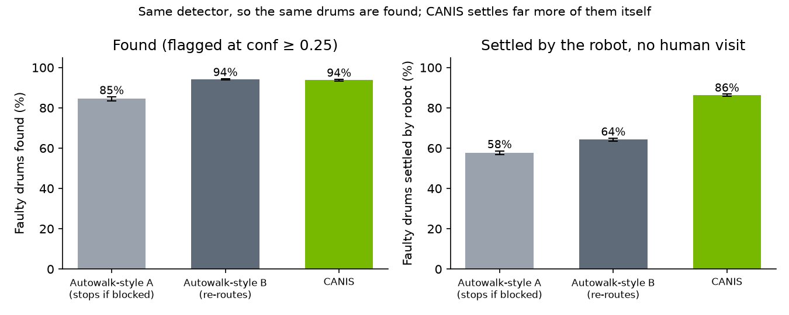
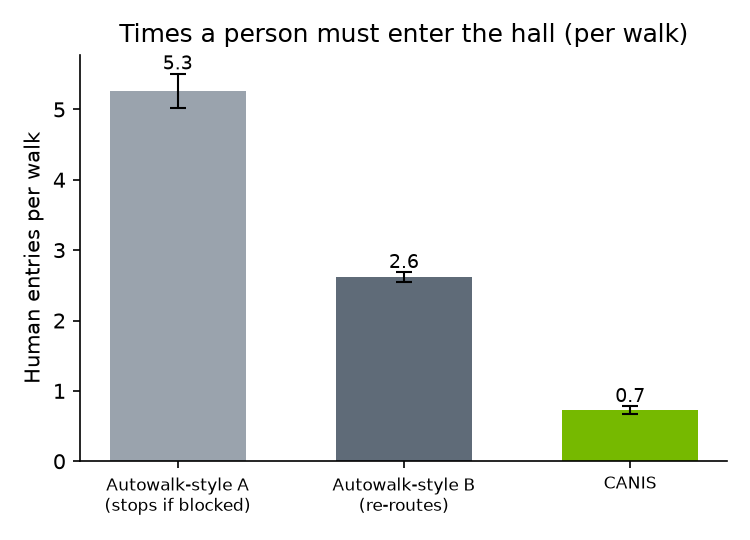

# CANIS evaluation

*As of 8 Nov 2026. Detector: YOLO26s (run `yolo26s_20261107T225757Z_d625ef`), cut-off 0.25. 2,000 paired simulated walks, seed 20261108.*

**Same robot, same detector, different decisions.** CANIS finds the same faulty drums as a fixed-route robot (93.8% vs 94.1%). It settles **22.0 percentage points more of them itself** (95% range 21.4 to 22.7) and leaves **72% fewer drums for a person to check** (95% range 70% to 74%). McNemar's test confirms the difference isn't luck.

## What we compared

Both robots have the same body, camera and detector, and walk the same pretend versions of our 28-drum hall. Only their decisions differ.

| | Fixed-route robot (Autowalk-style) | CANIS |
|---|---|---|
| Route | Fixed, recorded | Same start, changes plan |
| Photos per drum | 1 | 1, plus up to 2 more if unsure |
| If unsure about a drum | Leaves it for a person | Looks again; leaves it for a person only if still unsure |
| Blocked aisle | Walks round it | Walks round it |
| Radiation spike | Walks through it | Backs off, comes back later, keeps to a dose budget |

The fixed-route robot copies how today's inspection robots work, from public descriptions: a route recorded by a person and replayed, with set actions at each stop.

## Where the numbers come from

- **Measured:** the detector's results on 150 photos it had never seen. At confidence 0.25 it flagged 251 of 259 rusty drum views (96.9%) and wrongly flagged 2 of 303 clean ones (0.7%). It caught 243 of 274 bulges (88.7%). 121 of the 259 rusty views scored between 0.25 and 0.5, which counts as "unsure". The hall layout (28 drums) comes from `sim/drums.json`.
- **Simulated:** a fast Python simulation (`eval/canis_eval.py`) walks both robots through 2,000 random versions of the hall. At each drum, a random draw using the measured rates decides what the detector "saw": sure, unsure or nothing. Both robots get the same draws, so the comparison is fair.
- **Assumed (our settings):** each drum has a 30% chance of being faulty (35% of those are bulges), a radiation spike happens in half the walks, an aisle is blocked in 30% of walks, and dose is in simulated units, not mSv.

## Test 1: 95% ranges (paired bootstrap)

Each number is an average over 2,000 walks. To see how much it could move by chance, we re-drew our own walks at random with replacement 10,000 times and kept the middle 95% of the answers. **If the range of the difference doesn't include zero, the difference is real.**



| Per walk, average | Fixed-route | CANIS | Difference (95% range) | Real difference? |
|---|---|---|---|---|
| Faulty drums found | 94.1% | 93.8% | −0.3 points (−0.5 to −0.2) | About the same: same detector |
| Faulty drums settled by the robot | 64.2% | **86.2%** | **+22.0 points (21.4 to 22.7)** | Yes, CANIS better |
| Drums left for a person to check | 2.61 | **0.72** | **−72% (70% to 74% fewer)** | Yes, CANIS better |
| Walks over the dose budget | 10.2% | **1.2%** | −9.0 points (−10.4 to −7.8) | Yes, CANIS better |
| Robot dose (simulated units) | 2.60 | 2.58 | −0.02 (−0.11 to +0.08) | No: the range includes zero |
| Mission time (minutes) | 5.9 | 7.9 | +2.0 (1.9 to 2.1) | Yes, CANIS slower (the trade-off) |



## Test 2: McNemar's test

McNemar's test compares two robots drum by drum. Across all walks there were 16,631 faulty drums. For each one: **did each robot settle it itself?** Drums where both gave the same answer tell us nothing, so the test looks only at the two "disagree" boxes. If the robots were equally good, those two boxes would be about the same size.

| | CANIS settled it | CANIS didn't |
|---|---|---|
| **Fixed-route settled it** | 10,647 | 32 |
| **Fixed-route didn't** | **3,692** | 2,260 |

The disagree boxes are **3,692 vs 32**. A split that lopsided would almost never happen by chance (p < 0.001). CANIS settles drums the fixed-route robot can't.

The same test on drums *found* shows a small gap the other way. The fixed-route robot found 55 drums CANIS didn't, and CANIS found none it missed (about 0.03 per walk). CANIS stopped short of 50 of them to keep within its dose budget, reporting them as "Couldn't inspect". It called the other 5 OK after two clear extra looks.

## Limits

- **Simulation.** Only the detector results and the hall layout are measured.
- **Synthetic test photos.** The detector was tested on synthetic photos of drums, not real ones.
- **Drums, not trips.** "Drums left for a person" counts drums, and one person could check several in one trip.
- **Second looks.** Each second look is treated as a fresh draw. Real second looks may be less independent.
- **Dose units.** Dose is in simulated units.
- **Not yet done:** running both robots in Isaac Sim to check the simulation.

## Reproduce

```bash
python -m pip install numpy scipy pandas matplotlib
python eval/canis_eval.py --walks 2000 --boot 10000 --seed 20261108
python eval/make_charts.py
```
